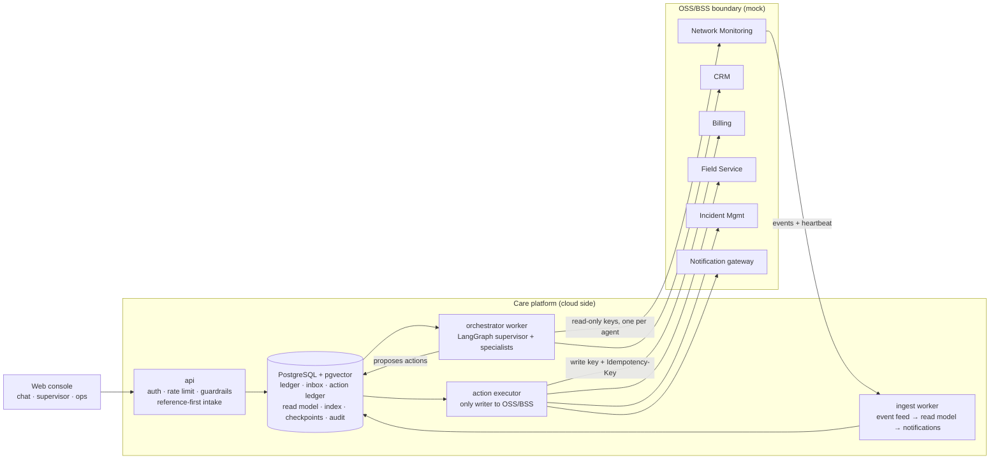

# Execution plan — G3 Telco outage-aware customer care agent

| | |
|---|---|
| **Scope** | Engineering plan for the working demo system (submission items 4 and 5) and the evidence it must produce for items 3, 6 and 7 |
| **Inputs** | `Group 3 - Telco_ Outage-Aware Customer Care Agent.pdf` (brief, **[B]**) and `G3_Telco_FDE_Action_Plan.pdf` (team delivery plan, **[AP]**) |
| **Baseline** | 15 Nov 2026. Submission 29 Nov 23:59 IST, presentation 30 Nov |
| **Relation to [AP]** | [AP] decides *what* and *why*. This document decides *how it is built, in what order, and how each claim is proven*. It does not restate [AP] |
| **Revision** | r4, 16 Nov — r2 revised the plan after an independent plan review and an architecture review (changes marked ▲); r3 recorded M0 and M1 as built; r4 records M0 to M4 as built (section 13), what each milestone's reviews changed, and where the build differs from this plan |

Section 13 is a living progress log. Everything above it is the plan.

---

## 1. Definition of done

The build is done when each brief metric has a named, repeatable proof. Targets are from [B]. Every row now has a measured result on the stand-in data (section 13); the half-hour surge is still to be repeated on the final code.

| Brief metric [B p.2] | Proof the build must produce | Built in |
|---|---|---|
| Outage detected for affected customers ≥ 95% | `evals/test_outage_detection.py`, scored as defined below | M2 |
| Unnecessary truck rolls cut ≥ 50% (simulation) | `evals/test_truck_rolls.py`: the kinds of contact that ended in a technician visit in the labelled data, replayed through the new workflow with a customer who goes on asking for one; also reports needed visits booked and the delay the hold adds | M2 |
| Credits match policy 100% | `evals/test_credit_policy.py`: independent exact-arithmetic oracle incl. 499.99 / 500.00 / 500.01, caps, rounding, prior credits; eligibility and amount both checked | M2 |
| Zero duplicate tickets per node | Concurrency tests: simultaneous contacts, response-loss retries, worker restarts, suspected-fault-then-confirmed-outage → exactly one incident per node episode, distinct complaint references | M1, M2, M3 |
| Available during a 10x surge | `loadtest/`: 1 contact/s → 10/s within 15 min, held 15 min, repeated with the Network API down. Pass: ≥ 99.5% of offered contacts accepted, every reference ≤ 120 s, first intake never rate-limited. The load test adds two of its own: every contact answered, and every customer who waited on the outage told of its end within 30 minutes | M3. The plan's three lines are met on the local stack by the half-hour profile (`loadtest/reports/surge-brief-before-fix.md`, run before the last fix) and all of them by the two-minute profile after it (`surge-quick.md`). The half-hour profile is to be repeated on the final code, and again on the full stack in M5 |
| Complaint reference within 2 minutes | Reference issued in the intake transaction before any model or dependency call; latency recorded for every contact (count, max, percentiles; internal goal p95 ≤ 5 s) | M1 |
| Curveball: safe degraded mode | Fault drills. Pass: zero false all-clear messages, zero dispatches on stale data, zero unauthorised credits, reference still issued | M3 |

**▲ How outage detection is scored.** The denominator is every contact from a customer whose *true* node is in outage at contact time, including contacts made before the NOC has declared the outage and customers whose mapping is defective. A contact counts as detected when it receives either an active-outage reply at contact time, or a suspected-fault hold at contact time followed by confirmation once the NOC declares the outage — and in both cases no device flow or dispatch was started. The report splits detected-at-contact, held-then-confirmed and missed, each by mapping status. Without the suspected-fault path and mapping repair (rules 3 and 4 below) the ceiling on the stand-in data would be about 77%, so those two rules are not optional.

Rubric items this build feeds directly: working agentic system (15), guardrails/security/compliance (10), evaluation and observability (8), curveball (6).

---

## 2. Starting position and assumptions

Facts on 15 Nov: the project folder contains only [B] and [AP]. The datasets, credit policy, router guides and mock APIs that [B] calls "provided" are **not** in hand, and no LLM credential is configured on the build machine. The plan is built so that work proceeds now and the unknowns stay cheap to correct.

| # | Assumption / default taken | Why it is safe to proceed | To confirm with | Cost if wrong |
|---|---|---|---|---|
| A1 | Supplied data pack and mock APIs are unavailable, so we build stand-ins: `skylink_datagen` (seeded synthetic data at brief scale) and `mock_oss` (stateful mock REST APIs with fault injection) | The agent system reaches them only through typed adapters and file loaders | Mentors / OSS-BSS architect | Rewrite adapters + loaders (bounded: `adapters/`, `pipelines/`); re-run evals |
| A2 | Credit policy content is unknown. A **synthetic placeholder policy** (`data/policies/credit_policy.v0.yaml` + policy document) drives a versioned, data-driven engine | [AP] forbids inventing a formula *as fact*; the placeholder is labelled, versioned and replaced by editing data, not code | Regulatory Affairs / mentors | Replace YAML + document + oracle table |
| A3 | The intake-ledger reference **is** the official complaint number; it is registered with Incident Management asynchronously | Only design that meets 2 minutes while Incident Management is down | Regulatory Affairs | Add reserved-range allocation |
| A4 | Credits > INR 500 always need supervisor approval. Credits ≤ INR 500 are also held for agent review (`CARE_CREDIT_REVIEW_ALL=true`) until mentors confirm auto-apply | [AP] p.2 default; one config flag flips it | Mentors | None (config) |
| A5 | LLM access goes through one narrow gateway. An **offline deterministic provider** is the default (tests, CI, surge fallback). ▲ The demo reads messages with OpenAI's `gpt-5.4-mini`, pinned to the dated snapshot `gpt-5.4-mini-2026-03-17` (D2, decided 18 Nov); Claude is one setting away | The gateway keeps each provider to one small class, and a reading a model cannot give falls back to the rules | Team (decided) | Add one provider class |
| A6 | Demo runtime: `make demo` runs the five processes on the host against PostgreSQL in Docker; `make stack-up` runs everything in containers (Compose). AWS is the reference target per [AP] ADR-01; no cloud spend until the team freezes the choice | Containers + PostgreSQL are cloud-neutral | Team (R2) | Architecture document only |
| A7 | NOC events arrive as an ordered change feed (sequence number, per-outage version, heartbeat). Locally this is an HTTP feed on the mock; in the target it is a Kinesis/Kafka stream | The consumer depends only on ordering, versions and heartbeat | NOC manager | Swap the feed client |
| A8 | Write APIs accept an `Idempotency-Key` and replay the original response for the same key and body | If they do not, the executor's own ledger plus lookup-before-retry still prevents blind repeats | OSS-BSS architect | Executor retry path only |
| A9 | Mobile is a thin path using the supplied static node mapping; no live tower inference | [AP] scope decision; one mobile journey is built and evaluated in M2 | — | — |
| A10 | No churn ML. A transparent repeat-contact flag (≥ 2 contacts in 7 days) may raise human-queue priority only; it never changes entitlement or wait order for service. An ADR is to record why the ML layer of the reference architecture is deferred (not written yet) | No outcome labels exist; avoids unfair treatment by segment | R1 | — |
| ▲ A11 | A remote line test reports the node that actually serves the line. It is used to repair missing, ambiguous and stale mappings | Read-only probe; without it defective mappings can never be detected as affected | OSS-BSS architect | Defective mappings go to the human queue instead |
| ▲ A12 | Network Monitoring exposes active alarms per node, and equipment alarms precede the NOC's outage declaration | This is what closes the 1–10 minute pre-detection window | NOC manager | Fall back to line-test clustering only |
| ▲ A14 | Proactive messages go only to customers whose consent record allows outage notifications **at the moment of sending**, on the channel that record names. One message per customer, outage and kind (started, resolved); an ETA change sends nothing. "Resolved" goes only to those who were sent "started". An outage learnt more than 15 minutes late is recorded but not announced | Consent can be withdrawn at any time; a late or repeated message is worse than none | Regulatory Affairs, Contact Centre Head | Change the fan-out rule in `ingest/reactions.py` and the two templates |
| ▲ A15 | No rule for closing a complaint has been supplied. A contact that waits for the customer (after "service restored", or after an unanswered question) is closed after 24 hours of silence, and at once when the customer confirms service is back. A message after closure reopens it for a person | A complaint that never closes is as wrong as one closed too early; the period is one setting | Regulatory Affairs | `CARE_CLOSE_QUIET_SECONDS` |
| ▲ A16 | While the network status cannot be verified the contact is looked at again every 60 s and handed to a person after 5 looks (5 minutes). A suspected node fault (alarm, no declared outage) waits up to 15 minutes, because the NOC needs minutes to declare; meanwhile one ticket is raised for the node and each complaint is linked to it, instead of one handoff per contact | Queues people only for what cannot settle by itself; all limits are settings | NOC manager, Contact Centre Head | `CARE_NETWORK_RECHECK_*`, `CARE_SUSPECTED_WAIT_SECONDS` |
| ▲ A13 | A customer who is not signed in and not on a recognised caller line is verified by two things they know: customer ID and the last four digits of the registered mobile, checked by the CRM. A typed ID alone is only a claim: nothing is looked up, disclosed or attached to the contact for it, and a wrong claim gets the same answer whether or not the account exists | Stops the conversation being used to discover accounts or another customer's outage status | Contact Centre Head, Regulatory Affairs | Swap the factor (for example OTP) inside the triage agent |
| ▲ A17 | On a healthy node about one line in fifty fails its remote test for reasons of its own (the customer's equipment, the drop cable). Three or more customers with a failing line on a node are a suspected node fault only when that many failures among the lines tested there would be a coincidence less than once in a thousand times (the synthetic pack has one line in seventy failing) | Found by the load test (16 Nov): a fixed count of three suspected one restored node in seven when every waiting line was tested after an outage. Too high a rate hides small partial faults from this rule, too low a rate suspects healthy nodes; alarms (A12) remain the first evidence | NOC manager | `CARE_LINE_OWN_FAULT_RATE`, `CARE_LINE_TEST_CLUSTER_CHANCE` |

---

## 3. Architecture as built

One repository, one container image, four care processes with separate credentials (API, orchestrator, executor, feed consumer), one database. The mock OSS/BSS gateway stands in for the on-prem boundary.



| Reference layer [B p.4] | Implementation | Package |
|---|---|---|
| 1 Channels | Static web pages: the customer chat, and the staff desk (credit approvals, the queue of handed-over cases, the operations queue, a contact's audit trail). The API also takes call transcripts from a trusted channel. Every message carries the AI disclosure | `skylink_care/web`, `skylink_care/api` |
| 2 Guardrails | Auth, rate limit, injection and PII checks in; grounding, citation and status-claim validation out | `skylink_care/guardrails`, `api` |
| 3 Orchestrator | LangGraph `StateGraph`, Postgres checkpointer, thread = contact; deterministic supervisor routing; step and time budgets (tool calls are not counted separately) | `skylink_care/orchestrator` |
| 4 Specialists | Triage, network diagnostics, troubleshooting (RAG), resolution and credit, dispatch, proactive notification | `skylink_care/agents` |
| 5 Human gate | Approval bound to the exact frozen request, policy version and expiry; verified again by the executor | `skylink_care/db/approvals.py`, `api/approvals.py`, `executor/credits.py` |
| 6 Tools and systems | One gateway key per agent identity, so each agent can reach only its own tools (enforced at the API boundary and by which clients a process is given); typed OSS adapters; every tool call audited; credit engine in code | `skylink_care/adapters`, `observability`, `domain` |
| 7 Data and ingestion | Event consumer and outage read model; customer → service → node pipeline with quality flags; versioned guide index; transactional inbox/outbox | `skylink_care/ingest`, `pipelines`, `rag` |
| 8 Trust and operations | Audit log, redacted structured logs, evaluation harness, attack suite, CI on GitHub Actions (D6). **Not built (M5):** OpenTelemetry traces, Prometheus metrics, dashboard, alerts, runbook | `skylink_care/observability`, `evals/`, `.github/workflows/ci.yml` |

Design rules that every milestone must keep:

1. **Reference first.** Contact, complaint reference and inbox row commit in one transaction before any model, CRM or network call. Intake has its own connection budget and a first contact is never rate-limited; overload is answered with a reference and status "queued".
2. **Evidence decides, language explains.** Branching uses typed state (outage status, test result, policy output). The LLM classifies intent and writes text; it never computes amounts, eligibility or network status.
3. **▲ Three-state network truth, asymmetric.** `ACTIVE`, `CONFIRMED_CLEAR`, `UNKNOWN`. Either fresh source (live status, or a caught-up event read model) may prove an outage. Only a fresh live answer may prove its absence, and only when nothing is suspicious: no critical alarm on the node or its parent, no cluster of failed line tests on the node. A timeout, a silent feed or an old answer is `UNKNOWN`. Customer wording is "no outage has been reported", never "there is no outage".
4. **▲ Probing is free, acting is gated.** A line test is read-only: it runs whenever the node is not known to be in outage, and its reported serving node repairs a defective mapping. Device guidance and dispatch need `CONFIRMED_CLEAR`. Dispatch additionally waits out the NOC detection window after the first failed test and re-checks immediately before booking.
5. **▲ One writer, frozen requests.** Agents propose actions into the action ledger; the row stores the exact request body. Only the executor process holds write credentials. It re-checks policy, approval, duplicates and current preconditions, then sends the stored body unchanged. A retry replays the same key and body; a changed request is a new, superseding action.
6. **▲ Identities are ours, enforced by constraints.** Complaint: one per contact. Incident: one per care-owned *node episode* (one open episode per node and service; the NOC outage id is attached when declared, so a suspected fault and its confirmed outage share one ticket). Credit: one per service per outage. Visit: one open visit per service.
7. **▲ Events are applied exactly once.** Every event for a contact lands in a per-contact inbox. A worker holds a per-contact database lock for the whole run, resumes the thread with a bare wake signal, and the graph drains the inbox from a cursor stored in checkpointed state. Redelivery, batching and stale versions are therefore harmless.
8. **▲ Threads stay small and end.** Thread state holds ids, the evidence summary and the inbox cursor; transcripts and tool outputs live in their own tables. A contact that closes ends its thread and its checkpoints are deleted.

---

## 4. Stack

| Concern | Choice | Note |
|---|---|---|
| Language, packaging | Python 3.12, `uv`, lockfile committed | Matches course labs |
| API | FastAPI + uvicorn | `/health`, an `X-Request-ID` on every response |
| Orchestration | LangGraph 1.2 + `langgraph-checkpoint-postgres` | `interrupt` / `Command(resume=…)`, async node timeouts and retry policies |
| Database | PostgreSQL 17 + pgvector, `psycopg` 3, plain SQL migrations | One stateful dependency: ledger, inbox, action ledger, read model, vector index, checkpoints |
| Queue | Inbox and action ledger in PostgreSQL, claimed under advisory locks | Maps to SQS FIFO (message group = contact) in AWS; no broker to run locally |
| Retrieval | Mandatory pre-filter (device model, doc type, role, quotable section), then keyword rules for the kind of fault, PostgreSQL text search and pgvector over a deterministic hashing embedder | ▲ As built: no learned embedding model; `fastembed` was not adopted (`evals/reports/retrieval.md`) |
| LLM | Gateway with offline deterministic provider, a Claude provider and an OpenAI provider (official SDKs, structured outputs) | Prompts are Markdown files versioned by content hash. ▲ The OpenAI provider was added after M4, when an OpenAI key was the one available; it is the only one run live |
| Observability | Audit log in Postgres with an in-app per-contact trail; structured, redacted logs; LangSmith traces of the workflow, opt-in, with inputs and outputs hidden. Planned for M5, not built: Prometheus metrics, Grafana dashboard and alert rules | ▲ LangSmith first dropped, then taken up after M4 for the workflow's traces only, because LangGraph sends them with no code: one setting and a key |
| Tests and load | pytest, pytest-asyncio, pytest-cov, respx; a load generator of our own in `loadtest/` (asyncio and httpx) | Coverage gate 80%. The surge of the brief is an arrival rate, which Locust's simulated users do not give: a user who waits for a slow answer offers less load, and the slowness goes unmeasured. The generator offers every contact on a fixed schedule and measures from when it was due |
| Delivery | Docker Compose; CI with lint, type-check, tests, coverage gate, image and secret scan | ▲ CI moves to M1. As built: GitHub Actions (D6, 19 Nov), which also runs the evaluations and publishes the image as a release candidate. Terraform is cut to a service-and-cost table unless time remains |

Reuse check: public LangGraph customer-support templates are LLM-routed chat demos without durable intake, an inbox or idempotent writes, so none is forked. The build relies on framework primitives instead of hand-rolled equivalents (checkpointing, interrupts, retries, timeouts).

---

## 5. Repository layout

```
├── docs/                    execution plan, ADR, contracts, threat model, data inventory, regulatory map,
│                            evidence index, plain-language guide (HOW_IT_WORKS.md); no runbook yet (M5)
├── src/
│   ├── skylink_care/        the agent system
│   │   ├── domain/          pure logic: references, credit engine, network decision, dispatch rules
│   │   ├── db/              pool, SQL migrations, repositories
│   │   ├── adapters/        typed OSS/BSS clients (network, crm, billing, field, incident, notify)
│   │   ├── agents/          the six specialists
│   │   ├── orchestrator/    graph, state, routing, worker
│   │   ├── executor/        action executor worker
│   │   ├── ingest/          event consumer, read model, notification fan-out
│   │   ├── pipelines/       customer → service → node load and quality profile
│   │   ├── rag/             chunking, embedding, index, retrieval
│   │   ├── guardrails/      input, output and PII controls
│   │   ├── llm/             gateway, providers, prompts
│   │   ├── api/             FastAPI app, auth, rate limit, routes
│   │   ├── observability/   redacted logging, audit writer (metrics: M5; traces: LangSmith, by setting)
│   │   └── web/             static console
│   ├── mock_oss/            stand-in OSS/BSS gateway (never imported by skylink_care)
│   └── skylink_datagen/     seeded synthetic data and knowledge pack
├── data/                    knowledge/ and policies/ committed; generated/ ignored
├── evals/                   frozen cases, harness, reports
├── loadtest/                the surge of the brief, offered to the running stack
├── tests/                   unit/ integration/ contract/ e2e/ mock_oss/ datagen/ support/
├── scripts/                 local secrets, dev-stack launcher, smoke run, attack-suite can-fail check
└── (root)                   Dockerfile, docker-compose.yml, Makefile, .github/workflows/ci.yml (no deploy/ folder)
```

---

## 6. Milestones and exit gates

Dates follow [AP] p.3; owners are the [AP] roles. A milestone closes only when its gate passes from a clean checkout. ▲ Each milestone ships the evaluation module for what it builds, so M5 only freezes, runs and reports.

| # | Dates | Owner (reviewer) | Delivers | Exit gate |
|---|---|---|---|---|
| **M0 Foundations** | 15–16 Nov | R3 data · R4 mock, adapters · R5 scaffold (R2) | Scaffold, Compose, settings, migrations; synthetic data + knowledge pack; mock OSS/BSS with scenario and fault controls; typed adapters; data profile | `make up seed` then contract tests green at small scale; one CRM and one Network call return typed results; mapping-quality profile written |
| **M1 Reference-first outage path** | 16–18 Nov | R4 (R2) | Intake ledger + inbox; complaint reference; API auth and tool-broker interface; orchestrator on Postgres checkpoints; triage; customer and node resolution; network decision; outage reply with sourced ETA; node episode + shared incident through action ledger and executor; audit trail; minimal chat page; **CI pipeline**; eval: reference latency | E2E test against running mocks; worker killed mid-run resumes without repeating a write; retry returns the same reference; 50 concurrent contacts on one node create one incident and 50 references; CI green |
| **M2 Six capabilities** | 19–21 Nov | R3 retrieval · R4 flows (R5) | Event ingest and read model; consent-checked proactive notification; line tests and mapping repair; suspected-fault hold; guide index and cited troubleshooting; credit engine, approval gate, billing write; dispatch with hold-down, consent and one-open-visit; conflict handling; handoff queue; supervisor console; one mobile journey; evals: detection, truck rolls, credit oracle, retrieval | Three named input changes flip the outcome: (1) start an outage on the customer's node → outage reply instead of troubleshooting; (2) change the router model → a different guide is cited; (3) move the outage duration across the INR 500 boundary → supervisor approval appears. Credit oracle 100% |
| **M3 Curveball and resilience** | 22–24 Nov | R5 (R4) | Timeouts, bounded retries and circuit breaker per dependency; `UNKNOWN` mode with status-claim validator; stale-feed detection; ambiguous-write replay; duplicate and out-of-order event replay; surge mode and load test; half a day held for the curveball *as released*, with an ADR recording the re-scope | Network-API-down drill and surge both meet the pass lines in §1; no duplicate effect after response loss |
| **M4 Trust** | 19–24 Nov, alongside | R5 (R1) | Roles; per-agent identity and broker enforcement; PII masking and log redaction; injection and retrieved-document checks; grounding and citation enforcement; toxicity and off-topic refusal; intent-confidence threshold → human with summary; loop limits; human override, logged; audit fields for model, prompt and policy version; segment-parity eval (consumer vs SME: same outage → same credit rule and dispatch); data inventory with retention; regulatory-controls map; threat model; attack suite (as built: 40 attacks) | Attack suite: zero critical failures (unauthorised credit, stale-data dispatch, cross-customer disclosure, false all-clear) and pass rate reported per LLM provider (as built: the keyword rules and a scripted model that obeys the attacker; no live model, D2); negative tests for wrong customer, wrong role and unauthorised tool; no raw identifier in any model payload |
| **M5 Evaluation and observability** | 25–26 Nov | R3 · R5 (R1) | Freeze the evaluation set; run everything on the full stack at 400,000-customer scale, including the surge re-run with auth and rate limits on; generated report with online-metrics and drift plan; dashboard (latency, errors, cost, groundedness) and alerts (error rate, latency, cost spike, stale feed); ADRs; checklist evidence index | One command regenerates the report with counts, denominators and failures; each alert shown firing once |
| **M6 Demo** | by 26 Nov | R4 (all) | Console polish, seeded demo fixtures, scripted six-minute story, live-input changes | Demo runs in ≤ 6 minutes from a clean start; a mentor-chosen customer, node or router model works |
| **M7 Freeze** | 27 Nov | R2 · R5 | Fresh-clone check, image and secret scan, pinned dependencies, deployment strategy with rollback exercised once, service-and-cost table, README with AI-assistant declaration | Fresh clone → running demo using only the README |
| **M8 Rehearsal** | 28 Nov | All | Full 30-minute rehearsal, backup recording | Backup MP4 plays offline |

**Status, 19 Nov:** M0 to M4 are built, ahead of the dates above (section 13). M5 to M8 are not started, except one piece of M5's tracing: after M4 the workflow's traces can be sent to LangSmith, with their contents hidden. An OpenAI provider was added after M4 too, and the attack suite run with it; the demo uses it (D2, decided 18 Nov). CI runs on GitHub Actions (D6, decided 19 Nov), and teammates run the build on Windows and Mac with Docker alone.

Development runs at 40,000 customers by default; tests and evaluations replay on a 1,000-customer pack (the evaluations weighted by a mix measured once on 400,000); 400,000 is the load profile. If the schedule slips, cut in [AP] order: UI polish, Grafana, optional cloud topology. Never cut the six capabilities, mock-API integration, approval, failure handling, reference timing or evaluation evidence.

---

## 7. Work breakdown, M0–M4

Each task lists its acceptance check. Tests are written first for `domain/` and the ledger logic.

### M0 Foundations

| Task | Acceptance |
|---|---|
| Scaffold: `pyproject.toml`, lockfile, ruff, mypy, pytest, Makefile, `.env.example`, `.gitignore`, Dockerfile, Compose (Postgres + pgvector for the care platform; the mock keeps its own SQLite store so the boundary stays honest) | `make lint test` passes; `docker compose up` healthy |
| `skylink_datagen`: nodes and topology; addresses; customers; services; address → node map with injected gaps (missing, ambiguous, stale); 6 months of alarms and outage events; 20,000 labelled transcripts; consent flags | Same seed → identical files; scale flag; schema in `docs/contracts/data.md` |
| Knowledge pack: 12 router guides with model-distinct facts, placeholder credit policy, placeholder complaint-handling rules; one deliberately hostile document for guardrail tests | Each guide has stable section ids; every model differs on at least five checkable facts |
| `mock_oss`: Network Monitoring (status with active alarms, line test, event feed + heartbeat), CRM, Billing, Field Service, Incident Management, Notification; scoped API keys; `Idempotency-Key`; admin scenario and fault controls | Contract tests per endpoint; replay of the same key returns the same result; fault modes: down, latency, error rate, timeout, response loss after write |
| Typed adapters with a `Result` type (ok / error kind, source timestamp, external reference), timeouts and correlation headers | Contract tests against the running mock; every failure mode maps to a typed error, never an exception leak |
| Customer → service → node pipeline and mapping-quality profile | Coverage, ambiguity and staleness counts written to `reports/data_profile.md` |

### M1 Reference-first outage path

| Task | Acceptance |
|---|---|
| Complaint reference generator (sequence-backed, check digit) | Unit tests: format, uniqueness, check-digit validation |
| Intake: `POST /v1/contacts` writes contact + reference + inbox row + complaint-registration action in one transaction and returns before any dependency call | Same `client_request_id` → same reference; dependency outage does not affect the response |
| Inbox worker: per-contact advisory lock for the whole run, head-of-line ordering, attempt count, dead-letter to handoff | Two workers never run one contact at once; a crash releases the lock and the event is re-run harmlessly |
| LangGraph graph with Postgres checkpointer; one `await_event` interrupt resumed by a wake signal; inbox cursor in state; deterministic supervisor routing; budgets | Redelivered and batched events are applied once; restart resumes from the last checkpoint |
| Triage: identifier extraction, CRM lookup, intent; offline provider now, LLM provider behind the same interface | Unknown or ambiguous identity → reference kept, human handoff, no account data disclosed |
| Diagnostics: mapping lookup, live status with alarms, network decision with evidence | Unit tests cover every row of the decision table, including timeout, stale, conflicting and suspicious cases |
| Outage reply: template-backed status and ETA with source; no device flow while `ACTIVE` | Reply contains reference, outage id, sourced ETA, next step |
| Node episodes, action ledger with frozen request bodies, executor; incident create and complaint link | 50 concurrent contacts → one incident, 50 references; a replayed action sends the identical body |
| Audit trail on every step; minimal chat page; CI pipeline | One contact shows a complete step-by-step trail; pipeline green |

### M2 Six capabilities (summary)

Built in slices, each committed when its tests and a live run pass: **A** event feed, read model, timers · **B** proactive notifications and restoration · **C** line tests, mapping repair, line-test clustering · **D** guide index and cited troubleshooting · **E** credits, approvals, billing write · **F** dispatch · **G** conflict path and mobile journey · **H** supervisor console · I evaluations. All nine are done (see the progress log).

Event consumer with dedupe, version checks, applied-sequence tracking and heartbeat; alarm state per node; notification fan-out to resolved mappings only, consent checked at send time, one message per customer, outage and template; line-test tool and mapping repair; suspected-fault hold (critical alarm, or several failed line tests on one node) that opens an episode without an outage id; retroactive confirmation when the outage is declared; index build and filtered retrieval; step-by-step guided troubleshooting with citations; credit proposals only after restoration, priced from frozen inputs; approval records carrying the hash the approver saw; billing write under a per-customer lock; dispatch rules (failed re-test, fresh `CONFIRMED_CLEAR` after the hold-down, customer consent, one open visit per service); conflict path for "the network says outage, the customer says device"; handoff queue with summary; one mobile outage journey.

### M3 Curveball and resilience

The curveball as stated in [B p.2]: the Network Monitoring API goes down during a live outage, and every outage contact must get a complaint reference within 2 minutes; the build must show a safe degraded mode (no false "all clear", no truck dispatch on stale data). Most of the answer is in design rules 1, 3 and 4, built in M1 and M2: the reference is issued before any dependency call, a status that cannot be verified is `UNKNOWN` and never "clear", and acting needs proof. M3 adds what a surge on top of a failed dependency needs, and proves the whole of it. Built in slices like M2:

| Slice | Task | Acceptance |
|---|---|---|
| A | Circuit breaker per dependency in the one HTTP path (closed; open for a rest period; one probe), producing the `CIRCUIT_OPEN` result that callers already understand as "not attempted". One bounded retry for idempotent reads that fail fast | A dependency that keeps failing is called once per rest period, not once per contact. Every caller reads "not attempted" as "not verified", never as "nothing found". The HTTP layer never repeats a write |
| B | One live status read per node at a time: diagnoses of the same node that run at the same moment share the read that is on its way. An answer that has arrived is not kept for the next caller, not even for a second, and a turn woken by the feed does not share at all: it must not be answered with the status from before the news | Contacts on one node that are diagnosed together make at most half as many status calls as there are contacts; the re-check before a booking always reads for itself |
| C | Status-claim validator on every outgoing message: what a message claims about the network is declared with its template and checked, where messages are stored, against the evidence of the turn | A message that says the network is clear cannot be stored without fresh `CONFIRMED_CLEAR` evidence, whatever path produced it; a blocked message is audited and the customer gets the "not verified" wording |
| D | Operations queue: a failed or blocked action that belongs to no contact (a notification, a ticket update) and a feed that needs a person are queued for staff, shown on the staff desk and closed there | Nothing that needs a person exists only as a log line |
| E | Surge mode and load test: under load intake still answers with the reference and says that the reply will take longer; triage falls back to the rules while the backlog is long; `loadtest/` ramps from 1 to 10 contacts a second and holds, then repeats with the Network API down | At least 99.5% of offered contacts accepted, every reference within 120 s, no first contact rate-limited, in both runs. Added by the load test itself: every contact answered, and every customer who waited on the outage told of its end |
| F | The curveball as an evaluation (`evals/test_curveball.py`): a live outage with the Network API down in each fault mode, with the feed healthy and with it silent; an ADR for the re-scope | Zero false all-clear messages, zero visits offered or booked on unverified data, zero credits without approval, a reference for every contact, one incident per node episode |

### M4 Trust

The brief's three checklists (guardrails, security, compliance and responsible AI) are what this milestone answers: every ticked line needs evidence, every unticked line a reason. Much of the mechanism was built with the features it protects (M1 to M3): roles and object-level access on the API, a gateway key for each agent identity, masking before a model call, redaction in logs and the audit trail, the check on what a message claims, steps quoted only from the cited guide of the customer's router model, the confidence threshold, loop limits, approval bound to the exact request, model, prompt and policy versions in the audit trail. A survey of the code against the checklists (16 Nov, read-only, every item with file and test) found what is missing or weaker than those lines say. M4 builds that, in slices like M2 and M3:

| Slice | Task | Acceptance |
|---|---|---|
| A | Personal data out of model payloads and logs. Found: only the full name was masked by value, so a first name alone, an address or the last four digits of the registered mobile (half of the identity check) could reach an external model; the HTTP client logged the address of every request, a caller's line included; the redactor of logs and audit entries also hid dates, outage ids and one request id in ten | No identifier of the customer in any payload a model is handed, over 300 synthetic customers writing their own details in the spellings people use. A phone number is masked in a log line whichever logger wrote it. An audit entry keeps its times and the identifiers that tie it to other systems |
| B | An identity that holds. A contact bound to one customer cannot be moved to another by a second claim. Attempts to verify a claimed customer ID are counted across contacts and conversations, and after a few failures no further attempt reaches the CRM (four digits can be guessed in ten thousand tries, and nothing counted them). The negative tests the gate asks for as one table: every route against every role (as built; that a caller cannot reach what belongs to another is tested apart, for contacts) | The sixth wrong guess for one customer ID is answered like the first and makes no CRM call; a contact identified as one customer stays theirs; one test fails if a route is added without a row in the table |
| C | The attack suite as a scored evaluation (twenty cases or more; as built `evals/attacks/` and `evals/test_attack_suite.py`, 40 attacks and 58 runs): instructions in a customer's text and in a guide, a credit nobody approved, a visit on a status nobody could read, another customer's data, an all-clear without proof, personal data in a model payload, abuse and off-topic text, a role or an agent identity reaching past its own tools, a model whose answer tries to unlock an action. Each case names what would be a critical failure. The report names the provider and can be produced on the demo provider by a setting | Zero critical failures (unauthorised credit, stale-data dispatch, cross-customer disclosure, false all-clear); pass rate with counts; every case that fails is listed, not averaged away |
| D | What the suite and the survey show to be thin: an audit entry of its own for text that looks like an injection or abuse (today it is refused politely and leaves no trace); guide text scanned for instructions to the assistant, ~~and its stored hash checked before a step is quoted~~ (not built: the text about to be sent is checked instead); a check that quoted steps belong to the router model of the customer's service (as built, in the Troubleshooting Agent, not where messages are stored); the reason for a rejected credit required and written to the audit trail with who gave it; a person taking a contact over from the assistant, recorded | Each is a case of the suite or a journey test |
| E | Least privilege where it is cheap to prove: gateway scopes by what is read, so that the executor can read a customer's consent and nothing else of the CRM, and the identity that is provisioned and never used goes; limits that are constants become settings. A stretch, and the first to be dropped: one database role for each process, so that only migrations can alter the audit log (dropped: not built) | The simulator's scope table and the contract tests show each identity refused everything it does not use |
| F | Segment parity as an evaluation: consumer and SME customers through the same outages. Segment is not an input to any decision; the evaluation shows it by outcome: the same eligibility, the same rule for the amount (as built, the share of the fee differs where the policy's minimum lifts a small credit), the same decision on a visit. What differs is said: the fee, so the amount, and with the amount the level of approval | No difference that the fee does not explain, over paired cases |
| G | The documents the checklists ask for: a threat model against the OWASP Top 10 for LLM applications; a data inventory with purpose, source and retention; a map from the complaint-handling rule and the data-protection principles to controls; `docs/evidence_index.md`, in which every line of checklists 1 to 3 points at a test, a setting or a log, or has its one-line reason | Every line of the three checklists has a row |

Gate, from section 6: the attack suite has no critical failure and its pass rate is reported for each provider it ran on; negative tests exist for the wrong customer, the wrong role and a tool the caller is not entitled to; no raw identifier is in any model payload.

Not in M4, and said in `docs/threat_model.md` and `docs/evidence_index.md`: a real sign-in for staff (the staff key and typed name are a stand-in), a managed secret store, TLS and encryption at rest, limits at the edge. They belong to the deployment this build describes and does not have.

---

## 8. Test and evaluation strategy

| Layer | What it covers | Runs against |
|---|---|---|
| Unit | `domain/` (credit engine, network decision, references, dispatch rules), guardrails, chunking | Nothing external |
| Integration | Repositories, inbox, action ledger, checkpointer, retrieval | Real PostgreSQL |
| Contract | Each adapter and each mock endpoint, including fault modes | `mock_oss` in process |
| End to end | Full contact journeys through API, workers and mocks | In process (`tests/e2e/`); against the running processes by `make smoke` |
| Evaluation | Brief metrics, the curveball, retrieval quality, the attack suite and segment parity (all built) | `make eval`: the in-process stack and frozen cases; the Compose stack at full scale in M5 |
| Drills and load | Dependency failures, restarts, 10x surge | In process with the simulator's fault injection (`tests/e2e/`, `evals/test_curveball.py`); load against the running local processes (`loadtest/`); the container stack in M5 |

Rules: frozen expected outcomes before the final run; counts and denominators in every report; a dropped contact is a failure, not a deflection; evaluation cases are kept apart from prompt tuning; every report states which LLM provider produced it, and the attack suite is re-run on the demo provider once D2 is settled; coverage gate 80% on `skylink_care`.

---

## 9. Demo script to feature map

| Segment [AP p.11] | Needs | Milestone |
|---|---|---|
| 0:00–1:30 Outage starts, consenting customer notified, then contacts care | Scenario control, ingest, notification, outage path | M1 + M2 |
| 1:30–2:45 Confirmed-clear customer, correct router guide, tests fail, visit booked | Line test, retrieval with model filter, dispatch (hold-down shortened for the demo and shown on screen) | M2 |
| 2:45–4:15 Network API down and feed stale; new contact; retry | `UNKNOWN` mode, idempotent intake, dispatch block | M1 + M3 |
| 4:15–5:15 Credit above INR 500, supervisor approves, retry | Credit engine, approval gate, executor replay | M2 |
| 5:15–6:00 Trace, scorecard, incident dedupe, consent-denied suppression | Audit trail, eval output | M5 + M6 |

---

## 10. Submission artifacts fed by the build

| Item [B p.3] | From the build |
|---|---|
| 3 Architecture document | `docs/adr/`, diagram and flows in this plan, dependency failure table from M3 drills, service-and-cost table from M7 |
| 4 Repository + README | The repository; `.env.example`; AI-assistant declaration |
| 5 Demo + backup video | M6 script and fixtures |
| 6 Evaluation report | `evals/reports/` (written by `make eval`) and `loadtest/reports/` |
| 7 Checklists | `docs/evidence_index.md`: each checklist line → test name, config line or log; each unticked line (for example managed secret store and encryption at rest, which exist only in the target design) → a one-line reason |

Items 1, 2, 8 and 9 (deck, problem statement, ROI workbook, contribution matrix) are outside this plan; the data profile and evaluation numbers are their inputs.

---

## 11. Risks

| Risk | Mitigation |
|---|---|
| ▲ Contacts in the 1–10 minutes before the NOC declares an outage are told nothing is wrong and get a technician | Alarm-based suspicion, line-test clustering, dispatch hold-down, "not reported" wording; scored as misses if any of these fail |
| Supplied mocks arrive late with different contracts | Adapters isolate contracts; contract tests show exactly what breaks |
| Placeholder credit policy mistaken for the real one | Policy version `v0-placeholder` appears in every credit record, reply and report |
| Live LLM unavailable or slow during the demo | Offline provider and templates give a complete, safe path; backup video recorded after freeze |
| Surge backs up the orchestrator | Surge mode: callers are told at once and the model is spared while contacts queue; each orchestrator slot is refilled as it frees; diagnoses of one node share a status read; a failing dependency is rested; the executor serves complaint registration, incidents and credits before notifications. Measured by `loadtest/`. Still open: the wave of line tests when a large outage ends (D10) |
| Node-mapping gaps depress detection | Measured in M0; repaired by line test where possible; the rest goes to a human queue and is reported as coverage |
| Scope creep in UI | Console is static and thin until M6 |
| Little has been read by a live language model | The attack suite has been run once with OpenAI's `gpt-5.4-mini` (58 of 58; the model made all 24 readings). Every other evaluation runs on the keyword rules, and Claude has not been run (no key). The demo uses that model (D2); the other evaluations are to be run with it in M5 |
| A pipeline that has run only since 19 Nov, and deploys nothing | Every check that was run by hand before each commit now runs on each push to `dev` (GitHub Actions, D6): lint, types, the suite, the evaluations, the secret scan, the image scan. The image is published as a release candidate; a deployment waits for D4 and M7 |

## 12. Decisions needed

| # | Decision | Default in force | Needed by |
|---|---|---|---|
| D1 | Are the supplied datasets, policy and mock API contracts available? | Build on stand-ins (A1) | 16 Nov |
| ▲ D2 | Which LLM and provider is permitted for the demo? **Decided 18 Nov: OpenAI's `gpt-5.4-mini`**, pinned to `gpt-5.4-mini-2026-03-17`, the snapshot that served the attack suite's live run (58 of 58, `evals/reports/attack_suite_openai.md`). Every other evaluation ran on the keyword rules (M5 runs them with the model). Claude needs a key; one setting then runs the suite with it (`evals/README.md`) | Offline provider by default, so that tests, CI, load tests and anyone without a key run everything; `CARE_LLM_PROVIDER=openai` for the demo | 18 Nov (decided) |
| D3 | May credits ≤ INR 500 be applied without review? And is every affected customer credited, or only those who contacted us (as built)? | Review all (A4); only those who contacted us | 19 Nov |
| D4 | AWS or Azure for the reference deployment and cost estimate? | AWS (A6) | 16 Nov ([AP]: freeze on day 2) |
| D5 | Is the ledger reference the official complaint number? | Yes (A3) | 18 Nov |
| ▲ D6 | Where does the repository live and which CI runs it? **Decided 19 Nov: GitHub, with GitHub Actions** (`.github/workflows/ci.yml`). The GitLab definition, which never ran, is removed: teammates and mentors reach the repository on GitHub without an account elsewhere, and one pipeline that runs is better than two of which one never has | CI on every push to `dev` and every pull request | 17 Nov (decided 19 Nov) |
| ▲ D7 | Does the curveball as released differ from the one built in? | As stated in [B] | On release |
| ▲ D8 | May a line test run before the network is confirmed clear, to repair a defective mapping? ([AP] p.6 says confirmed-clear only) | Yes, read-only probe (A11) | 18 Nov |
| ▲ D9 | Is customer ID plus last four digits of the registered mobile an acceptable identity check for unauthenticated contacts? As built since M4 it cannot be guessed at one customer (ten wrong answers a day at most). But one guess in ten thousand is right for somebody: spread over many customer IDs at under fifty an hour, that is about one account in eight days, and nobody is told. A one-time code to the registered mobile would close it and needs SkyLink's SMS channel | Yes (A13), with the limits of M4 slice B | 19 Nov |
| ▲ D10 | When an outage ends, is every waiting customer's line tested before they are told (today), or a sample of lines on each node? In the half-hour load run the line tests for 9,759 waiting customers took 19 minutes to work through, one test of about a second each, eight at a time | Every line | 24 Nov |
| ▲ D11 | With the Network Monitoring API down, how long does a contact on a node with no declared outage wait before a person takes it? Today five minutes (A16). In the load test's half hour with the API down that put 2,693 of 3,361 such contacts in the human queue, about three a second once the API had been down for five minutes | Five minutes, as built (`CARE_NETWORK_RECHECK_LIMIT`) | 24 Nov |

## 13. Progress log

| Date | Milestone | Status |
|---|---|---|
| 15 Nov | Plan | r1 written; reviewed independently for completeness and for architecture; r2 incorporates both |
| 15 Nov | **M0 Foundations** | **Done.** Gate met: Compose stack healthy; data pack generated (400,000 customers in about 15 s) and loaded (about 5 s); adapters pass contract tests against the mock; mapping profile in `reports/data_profile.md` (coverage: broadband 96.86%, mobile 96.78%) |
| 15 Nov | **M1 Reference-first outage path** | **Done, except that CI has not run on a runner.** Gate met by tests and by a live run: reference issued at intake (10–20 ms locally); worker killed mid-run repeats nothing; retry returns the same reference; concurrent contacts on one node share one incident; restart between turns resumes the conversation |
| 15 Nov | M4 items pulled forward | API roles and object-level access, per-agent gateway keys with least privilege per process, PII masking, log and audit redaction, per-caller rate limits, identity verification (A13) |
| 15 Nov | **M2 slice A: event feed, read model, timers** | **Done.** A fifth process (`care-ingest`) reads the NOC feed with its own read-only key and applies each event, its consequences and the cursor in one transaction. The network decision now has both sources: the feed proves an outage while the Network API is down; a silent, stale, lagging or gapped feed proves nothing. Timers wake a contact later (re-check, quiet close) |
| 15 Nov | **M2 slice B: proactive notifications and restoration** | **Done.** Declared outage → consent-checked messages to the customers on the node, "resolved" only to those told it started. A suspected fault raises one ticket for the node, which the declared outage upgrades. Waiting customers are told when the outage is confirmed and when it is resolved; the contact closes on their confirmation or after a quiet period |

| 15 Nov | **M2 slice C: remote line tests** | **Done.** A line test names the node that really serves the line, which repairs a missing, ambiguous or stale mapping for the contact (the three defective-mapping journeys now end in the outage reply instead of a human queue). A failed line on a node that looks healthy is watched for the NOC's detection window before any repair is arranged; three distinct lines failing on one node are treated as a suspected node fault with one ticket. Dispatch itself is slice F |

| 15 Nov | **M2 slice D: guide index and cited troubleshooting** | **Done.** The twelve router guides are indexed by section in PostgreSQL (text search and pgvector). With a clear node and a passing line, a customer who asks gets the steps for their own router model, quoted with guide, section and version; a different router model gets a different guide for the same complaint (gate input 2). Steps are given once. On a turn the platform starts itself the customer is told the checks are clear and asked, not instructed |

| 15 Nov | **M2 slice E: service credits, approvals, billing write** | **Done.** At restoration a credit is worked out by the policy engine from Billing's record and the NOC's outage times, proposed with its amount frozen, and approved through the API by an agent or, above INR 500, a supervisor (gate input 3: one more hour of outage moves the credit past the limit and the approval to a supervisor). The executor applies it under a per-customer lock, after checking again, on what is true then: the request against its hash, the approval the amount requires, the account for an existing credit, and the billing-cycle cap. The customer is told the outcome of every credit; the contact stays open until then |
| 15 Nov | **M2 slice F: technician visits** | **Done.** A line that still fails after the hold on a node proven clear is offered a visit with the earliest free slots; the customer's reply is read by rules, narrowly; the chosen slot is proposed as an action tied to the message that chose it, and the executor books it after applying the same rule again to evidence it reads itself (node state, the line's last test, Field Service's bookings). An outage declared after the offer, or between the choice and the booking, means no visit. One booking in progress per service is a database constraint |
| 15 Nov | **M2 slice G: disputed outage, mobile journey** | **Done.** A customer who says the fault is their own equipment, or asks for a technician, during an outage is told the outage with its evidence and why nothing is arranged for their equipment while it lasts; said again for the same outage, a person takes it. Mobile is a thin path (A9): tower outage told, ticketed, restored and credited by the mobile rule, with no router wording, no line test and no visit; on a working tower a person takes over |
| 15 Nov | **M2 slice H: staff desk** | **Done.** A second page of the console for an agent or a supervisor: the credits that wait for a decision (the frozen request, its working, approve or reject with a note) and the queue of contacts passed to a person (handover summary, conversation, audit trail, closed with a note; the closure is audited with who closed it). Staff sign-in through the dev token endpoint now needs a staff key and takes a name, so a decision is attributable and the endpoint no longer hands an approver's token to whoever can reach the port |
| 15 Nov | **M2 slice I: evaluations** | **Done.** `make eval` replays contacts through the real workflow and writes a report for three of the brief's metrics and for retrieval (`evals/reports/`, method in `evals/README.md`). On the stand-in data: outage detected for 97.47% of affected contacts (target 95%); credits match the policy in 4,050 of 4,050 cases; the workflow books none of the baseline's 3,225 unnecessary visits and every needed one, and what is left end to end is decided by people; the right guide section for 81.25% of descriptions the retriever was not built on. The first runs missed and said why: five transcript phrases were answered as out of scope (detection 91.44%), and search by shared words found the right section for 77.6% of the transcript phrases. Both were fixed in the product, not in the scoring |
| 15 Nov | **M3 slice A: circuit breaker and bounded retry** | **Done.** One circuit for each API of the gateway, in the single HTTP path: five failures in a row rest the API for ten seconds, calls to it are answered `CIRCUIT_OPEN` ("not attempted") without being made, then one call probes. A read that fails fast is tried once more; a timeout is not, and the HTTP layer never repeats a write. Every call has a limit on its whole duration. With the Network API down, 30 contacts cost at most 19 calls instead of 60 and more, each gets its reference and the "can't verify" wording, none an all-clear; an account lookup that was not attempted is never an account that was not found; a write to a rested API is recorded as not sent and lands once when the API is back |
| 15 Nov | **M3 slice B: shared status reads** | **Done.** Diagnoses of one node that run at the same moment share one read of its live status; nothing is kept once the read has finished. Twelve and more contacts on a node in outage make at most half as many status calls as there are contacts. Two callers do not share: a turn woken by the feed, which must see the node as it is after the news, and the executor before it books a visit |
| 15 Nov | **M3 slice C: no claim about the network without proof** | **Done.** Each of the 33 templates a conversation can send declares what it claims; a message is stored only if the network decision of its turn backs the claim, and that decision and the status it rests on must both be less than a minute old. A step that acts on what it is about to say asks first, so no credit, ticket or booking is proposed on the strength of a message that will not be sent. A stopped message is audited and the contact goes to a person at once. The full suite passes with the check on every message, which is the evidence that no path of the workflow says more than it has proved. Journeys with a defect put in on purpose (an all-clear on an unverifiable status, an outage announced on a clear node, "service restored" with the Network API down and the feed stale) end with the message stopped, a person told and nothing done. The customer's page takes "none reported" back after a minute, and a resolution is announced only while its feed event is current |
| 15 Nov | **M3 slice D: operations queue** | **Done.** What needs a person and belongs to no contact is queued instead of only logged: a failed, blocked or long-delayed write that no conversation waits for, and a feed that cannot go on by itself. One open item for one kind of trouble; it keeps how the trouble began and counts when it is seen again. All staff see the queue on the desk; operations staff and supervisors close an item, with a note, and the closure is audited. Raising an item can never be what stops the feed or the executor |
| 16 Nov | **M3 slice E: surge mode and load test** | **Done.** While contacts queue for the orchestrator, a caller is told at once that the reply will take longer and messages are read by the rules; staff see the backlog on the desk. The orchestrator's loop now refills a slot the moment it frees: a batch made every contact wait for its slowest member. A channel's callers are counted by the line it names, and the channel as a whole is bounded. The surge of the brief, offered to the local stack: 100.00% and 100.00% of the offered contacts accepted, the slowest reference after 0.253 s, no first contact turned away, no all-clear with the Network API down. The first full run met every target and still showed a defect in what followed it: restored nodes suspected again because a few of the hundred lines tested on each had faults of their own. The rule for failing lines now sets them against what coincidence explains, and the report judges whether every contact was answered and every waiting customer told. On that code the two-minute profile meets all of it (1,324 of 1,324 waiting customers told, no restored node suspected). The half-hour profile has not been repeated on the code after that fix: two attempts were cut short when the laptop running them went to sleep on battery |
| 16 Nov | **M3 slice F: the curveball as an evaluation** | **Done.** One scene (two declared outages, a visit on offer, the API fails, customers write in, one outage is resolved, the API returns) played for four ways the Network Monitoring API can fail and two states of the event feed. In 8 of 8 playings, for 72 contacts: a reference for each, nobody in an outage told that the network is clear, no visit booked without a status read at that moment, no credit applied, one incident a node; and once the API was back, 16 of 16 customers on the lasting outage and 8 of 8 waiting on the resolved one had been told. The decision is recorded in ADR 0001, one of whose costs the evaluation corrected: a slot picked while the status cannot be read is not booked later by itself, the visit is offered afresh |
| 16 Nov | **M3 Curveball and resilience** | **Done on the local stack.** Gate: the Network-API-down drill (`evals/reports/curveball.md`) and the surge (`loadtest/reports/surge-brief-before-fix.md` for the half-hour profile, `surge-quick.md` on the code of M3) meet the pass lines of §1. No duplicate effect after a lost response: an incident write and a notification whose answer is lost are replayed into one (`tests/e2e/test_edges_and_degraded_mode.py`, `test_proactive_notifications.py`, `test_reliability.py`), and a page of the feed delivered twice or out of order has no second effect (`tests/integration/test_feed_consumer.py`). Open: the half-hour load profile repeated on the final code (`make loadtest`, two hours on mains power); decisions D10 and D11; CI has not run on a runner (D6); the container stack was last started in M2, and M5 repeats the surge on it |
| 16 Nov | **M4 slice A: personal data out of model payloads and logs** | **Done.** A survey of the code against the brief's three checklists opened M4 (work breakdown in section 7). First found, first fixed: only the customer's full name was masked by value before a model call, so a first name alone, an address, or the last four digits of the registered mobile (half of the identity check, and typed into the very message that completes it) could reach an external model. Everything the CRM profile holds is now masked by value, in the spellings people use. In the logs, the HTTP client wrote the address of every request, a caller's number included, past the redactor; and the redactor of logs and audit entries hid the dates of the evidence, outage ids and one request id in ten. Both are fixed, and secrets are now taken out by name at any depth and out of sentences |
| 16 Nov | **M4 slice B: an identity that holds** | **Done.** Two ways round the identity check of a customer who is not signed in (customer ID and the last four digits of the registered mobile) are closed. A caller verified as themselves could offer another customer's ID and digits in the same conversation and it became that customer's: a contact is now bound to the customer it was first verified as, in the database, and what is typed into it afterwards is not looked at. And nothing counted wrong answers for one customer ID across conversations, so four digits could be guessed by opening conversations: tries are now counted for the claimed ID, taken before the answer is checked, and after five wrong within an hour or ten within a day no further answer for it reaches the CRM. The gate's negative tests are one table: every route of the API against every role (wrong role refused, no token refused, a route without a row fails the test), beside the tests of the wrong customer |
| 16 Nov | **M4 slice C: the attack suite** | **Done, and it found five gaps.** 38 attacks against the whole platform (`evals/attacks/`, report `evals/reports/attack_suite.md`), scored on what a customer, an auditor or the enterprise systems could see afterwards. The 18 that lie in how a message is read are tried twice: read by the configured provider (the keyword rules; a Claude model by a setting), and by a scripted model that answers whatever the attacker wants. As first measured: 50 of 56 runs pass, **no critical failure**. The six runs that fail are five gaps, none of them one of the four critical outcomes, and slice D closes them: an instruction planted in a step of a real guide is quoted to the customer; so is a step changed in the stored index; a rude customer in an outage is declined instead of told of the outage; a model that reads "it works" into "it is still not working" closes the complaint; a model that calls a plain fault report off-topic gets it declined. **The suite's own first form did not hold up**, and that is the more useful finding. An independent review and a script that takes controls out of the source (`scripts/attack_suite_can_fail.py`) found attacks that could not have failed: a credit demanded where none could be owed, a technician demanded on a line that passed and for less than the hold, another customer's ID offered with digits in a form the check does not read (a journey test of slice B had the same fault), and a harness that reported "met" when attacks crashed. Each attack is now played where what it asks for could happen; an attack that cannot be played out makes the target not met; and all nineteen removed controls are reported by the attack meant for them, with the second lock holding where there are two |
| 16 Nov | **M4 slice D: what the attack suite found, closed** | **Done.** All 58 runs of the suite pass (40 attacks: two were added). (1) The keyword rules now look at every message beside whoever reads it. Known injection phrasing with nothing of a fault in it is declined whatever a model made of it; a reading that calls a plain fault report off-topic goes to a person; abuse with a fault report is handled as a fault (before, a rude customer in an outage was told the assistant could not help); a complaint is not closed on a reading of "it works" when the customer's words say it does not. A flagged message leaves an audit entry. (2) Guide steps are quoted verbatim, so they are checked: a step that speaks to an assistant, of money, asks for a code or sends the customer to a number or an outside address is refused at the index build, and the passage about to be sent is checked again and must be from the customer's own router's guide. (3) A credit cannot be rejected without a reason, and the reason is in the audit trail. (4) An agent or a supervisor can take any conversation from the assistant, with a reason, on record: the human override of checklist 3. The stored hash of a guide is **not** checked before a step is quoted, as this breakdown first said it would be: whoever can change a row of the index can change its hash, so the check would show little. What is checked is the text that is about to be sent |
| 16 Nov | **M4 slice E: least privilege at the gateway** | **Done.** The CRM scope is split by what is read: a profile (`crm:profile`), the check of what a caller knows (`crm:verify`), and whether a customer may be sent a notice (`crm:consent`). Only triage holds the first two; the executor, which sends the notices, holds the third and can read nothing else of the CRM (before, its key could read any customer's profile). The `notification` identity, provisioned with a key and a scope and used by nothing, is gone: a key nobody uses is a key somebody can lose. The API's limits on callers are settings. **Not built** (the stretch of the breakdown): a database role for each process. Every process still connects as one role, so a process that is taken over can write to any table; the audit log refuses rewriting only through a trigger the same role could remove |
| 16 Nov | **M4 slice F: the same outcome in both segments** | **Done.** The platform is given one attribute of a customer that a decision must not rest on, the segment (consumer or SME). It is read nowhere: a test reads the source for it, and for the name and the email address, which are read in one place, to be masked (`tests/unit/test_decision_inputs.py`). And by outcome (`evals/reports/segment_parity.md`): customers of both segments in eight situations are told the same, handed over the same at the same priority, offered a visit the same, and owed a credit by the same rule. What differs is the monthly fee, so the amount, and above INR 500 a supervisor approves: SME plans cost more and reach that level sooner. That follows from the placeholder policy and is for SkyLink to confirm |
| 16 Nov | **M4 slice G: the documents the checklists ask for** | **Done.** `docs/threat_model.md` goes through the OWASP Top 10 for LLM Applications (2025) and what that list does not cover: for each risk how it could happen here, what stands in the way, where that is shown, and what is left. `docs/data_inventory.md` lists what is held, why, from where and for how long, what leaves the platform, and the privacy principles one by one. `docs/regulatory_controls.md` maps the complaint-handling rules (a placeholder, decision D1) to controls and tests. `docs/evidence_index.md` takes checklists 1 to 3 line by line: 18 ticked with evidence, 6 ticked in part with what is not shown, 2 not ticked with the reason (a managed secret store; TLS and encryption at rest) |
| 16 Nov | **M4 Trust: the gate** | **Met on the local stack, with one thing not run.** The attack suite has no critical failure: 58 of 58 runs of 40 attacks pass, read by the keyword rules and by a scripted model that obeys the attacker (`evals/reports/attack_suite.md`), and 27 controls taken out of the source one at a time are each reported by the attack meant for them (`scripts/attack_suite_can_fail.py`). **It has not been run against a live language model**: that is one setting and a key away, and waits for decision D2. (Run after the gate with OpenAI: see the next row.) Negative tests exist for the wrong customer (`tests/e2e/test_identity_holds.py`, attacks E1 to E5), the wrong role (every route against every role, `tests/integration/api/test_role_matrix.py`; attacks C1, C2, I1, I3) and a tool the caller is not entitled to (`tests/mock_oss/test_auth.py`, `tests/contract/`; attack I2). No raw identifier is in a model payload (`tests/unit/llm/test_model_payloads.py`; attacks G1, G2). All seven evaluations were run again on the final code (`make eval`, 78 tests): the same results, but for the two playings of the curveball in which the API fails at random, which differ from run to run and broke no rule in either. What M4 leaves open is in `docs/evidence_index.md` and `docs/threat_model.md`: a managed secret store, TLS and encryption at rest, a database role for each process, a retention job, a real sign-in for staff, limits at the edge, and a CI pipeline that has never run (its image scan was run by hand: `docs/evidence/image_scan.md`) |
| 16 Nov | **After M4: an OpenAI provider, the attack suite read by a live model, LangSmith traces** | **Done.** An OpenAI key and a LangSmith key were given; which model the demo may use is still decision D2. (1) `llm/openai_provider.py` reads a message as the Claude provider does, in OpenAI's shape: Chat Completions with a strict JSON schema, `store: false`, nothing beside the masked text that tells customers apart, low reasoning effort. The default model is `gpt-5.4-mini` (`CARE_LLM_OPENAI_MODEL`), chosen by a probe of five models on three messages: all answered within 2.5 s, and `gpt-5.4-nano` was talked into "billing, credit requested" by an injection that `gpt-5.4-mini` read as off-topic. The worker stops at start-up without `OPENAI_API_KEY`. The test that searches a model's request for the customer's details now searches both providers' requests. (2) The attack suite was run with it twice, on the code before and after the review below: 58 of 58 runs each time, the model made all 24 readings, 1.2 s median and 1.8 s at the slowest in the second run (`evals/reports/attack_suite_openai.md`). A live run now counts as met only if every reading was the model's own (`evals/model_tally.py`). (3) LangSmith traces each turn of the workflow when `LANGSMITH_TRACING=true`: the steps, their timings and errors. Their inputs and outputs are hidden unless a setting asks for them, by default in code (`observability/tracing.py`); checked on the traces of the live run. A review found nothing critical or high. Its four findings are fixed: a live run that had mostly fallen to the rules still counted as met; an OpenAI admin key in the environment let the worker start without the API key; the default that hides the traces' contents was in the Compose file only; and no test used the SDK's own response types |
| 18 Nov | **Sharing the build: D2 decided, Windows and Mac** | **Done.** (1) D2: the demo uses OpenAI's `gpt-5.4-mini`, pinned to the dated snapshot `gpt-5.4-mini-2026-03-17` that served the attack suite's live run (one live call with the snapshot as the model id first); the default stays offline. (2) Teammates run the build on Windows and Mac. Every base image and locked package has a Linux arm64 build, so Apple Silicon builds natively. A checkout by Git for Windows' default (CRLF) stopped the container stack's setup script at its first command under `sh`, so the stack never seeded; `.gitattributes` now keeps LF on every checkout, and `.env` is written with LF. The processes do not run on Windows directly (Unix signals; the database driver's async mode refuses Windows' default event loop), so Windows runs the container stack, or WSL 2 for development. (3) The simulator's controls are `mock-oss` commands (`outage-start`, `line-fault`, `chaos network down` and the rest), run with `docker compose exec mock-oss ...` the same way on every system: no curl or shell syntax in a demo. (4) The README starts with a quickstart that needs Git, Docker and `uv` only |
| 19 Nov | **CI on GitHub Actions (D6)** | **Done.** `.github/workflows/ci.yml` replaces the GitLab definition, which never ran: lint and strict typing; the suite on PostgreSQL with pgvector, with the 80% coverage gate; the seven evaluations, their reports kept; gitleaks over the whole history; the image built, scanned by Trivy for HIGH and CRITICAL vulnerabilities that have a fix, and on `dev` published to the GitHub container registry as a release candidate. Actions are pinned to commits. Run first as a runner would (a clean clone, its own database, only the workflow's variables), it found what no run on this machine had shown: two tests that could not pass there. One asserted the default environment while the CI sets `CARE_ENV=test`. The other asked for an approval on the test helpers' fixed date and decided it on the real clock, so it had begun to fail on every machine three days after that date (18 Nov). Both are fixed in the tests; the code was right. The secret scan of the history found two test fixtures (a made-up JWT, a test signing key), listed by fingerprint in `.gitleaksignore`. The image, rebuilt with the OpenAI SDK in it, has no HIGH or CRITICAL vulnerability with a fix (`docs/evidence/image_scan.md`) |

### Evidence at this point

- The suite: 2,658 tests pass (unit, integration on PostgreSQL, adapter contract tests against the mock, end-to-end journeys), in CI on GitHub Actions on 19 Nov, [run 44446727763](https://github.com/cybervava/capstone_telecom/actions/runs/44446727763); 96% branch coverage on `skylink_care` (95.85% in the clean-clone run of the same day); `ruff` and `mypy --strict` clean. (2,585 at the M4 gate; 2,643 with the OpenAI provider and the traces; the rest came with the simulator's commands and the line-ending fix.)
- CI's first run (the same run): all five jobs passed, lint in 0.3 min, the suite in 8.4, the evaluations in 4.0, the secret scan in 6 s, and the image in 1.0 (built, scanned, published). The release candidate `ghcr.io/cybervava/capstone_telecom:3118d17ee8a2` (also tagged `dev`) can be pulled without signing in; it is built for linux/amd64 only, so on Apple Silicon the Compose file's own build, which is native, is the one to use.
- The attack suite read by a live model, after M4: OpenAI's `gpt-5.4-mini` read the messages of the 18 attacks made of words. 58 of 58 runs passed; the model made all 24 readings, 1.2 s median, 1.8 s at the slowest (`evals/reports/attack_suite_openai.md`). Its traces in LangSmith carried the steps and their timings, with inputs and outputs empty.
- `make eval`: the seven evaluations meet their targets on the stand-in data, in process, with the offline rules. Curveball: every rule held in 8 of 8 playings (72 contacts). Attack suite: 58 of 58 runs of 40 attacks, no critical failure. Segment parity: 8 of 8 situations end the same way for consumer and SME customers (80 customers). Detection: 97.47% weighted over 140 replayed contacts on 32 nodes. Credits: 4,050 of 4,050 grid cases and 14 of 14 hand-worked amounts. Technician visits: 0 of 28 unnecessary ones booked by the workflow (all 28 customers, who went on asking, ended with a person), 10 of 10 needed ones booked, a median of 10 minutes after the contact. Retrieval: 81.25% on the 48 independent descriptions as first scored (constant answer: 47.92%; 89.58% on today's rules, no longer out-of-sample), 99.07% and 96.67% on the two in-sample sets, no answer from another router model's guide.
- `make smoke` passes against the host processes at 400,000-customer scale (eight journeys with `make demo`, which shortens the hold before a visit to 20 seconds; seven with `make dev`): declared outage → sourced reply, one incident, complaint linked, and 168 neighbours on the node notified once each (none without consent, checked in the gateway's own store); Network API down → the feed still proves the outage; same failure for a customer on another node → no all-clear and no device steps; outage resolved → the waiting customer is told, confirms, the contact closes and the node's incident is resolved; a failing line on a healthy node → held, nothing booked; a passing line on a healthy node → steps from the guide for the customer's own router, with the source; a five-hour outage → credit proposed, approved by an agent through the API, applied to the account once; the held line still failing after the hold → a visit offered with three slots, the customer chooses the second, one appointment booked for exactly that slot.
- The README's quickstart, from a fresh clone made the way Git for Windows makes one (line-ending conversion on), on Linux, 18 Nov: no file with CRLF in the checkout (the same clone of the commit before `.gitattributes` had 20 in the setup script), `.env` written with LF by `uv run --no-project scripts/init_env.py`, `docker compose --profile stack up -d --build --wait` healthy in 27 s with a warm build cache (40,000 customers generated in 1.7 s, seeded, guides indexed), about 310 MB of memory for the six containers, both desks answering, and `scripts/smoke.py` passing all eight journeys against it in 41 s with the demo timing set in `.env`. The `mock-oss` commands drove a scene through `docker compose exec`: customers found, an outage started and its two notices read back, the Network API taken down and brought back, the outage resolved. Not yet run on a Windows or a Mac machine.
- `make smoke` also passes against the container stack (40,000 customers), where the feed consumer runs as its own service. Its first run there failed, usefully: re-seeding the gateway restarts its event sequence and empties its tickets, while the care database still held the cursor and ticket references of the previous gateway. The consumer refused the feed (sequence running backwards) exactly as designed. `make seed` and the container set-up now clear the care platform's runtime state in the same step (`care-admin reset-runtime`, refused unless `CARE_ENV` is `dev` or `test`).
- Both desks were checked in a browser at 1440 px and 375 px after slice H: sign-in as a supervisor, a supervisor-level credit approved, a case opened and marked done, the audit trail opened from the customer desk with the staff key; no console errors, no horizontal overflow.
- After M3 slices A to D, against the local stack at 400,000-customer scale: `make smoke` passes all eight journeys with `make demo` (the check waits out the circuit's rest after the journeys with the Network API down; without that wait six checks failed, which is the breaker doing its work). The staff desk's Operations panel was looked at in a browser at 1440 px and 375 px, signed in as operations staff: two items listed with the more urgent first, one closed with a note and gone from the list, no console errors, no horizontal overflow. On the customer's page the network chip read "none reported" with its time and, a minute later, "not verified".
- M3 slice E, against the local stack at 400,000-customer scale (`make loadtest`; one machine, which also ran the generator, the simulator and PostgreSQL). The half-hour profile, run before the fix to the rule for failing lines (`loadtest/reports/surge-brief-before-fix.md`). With every dependency up: 13,941 of 13,941 offered contacts accepted; reference in the caller's hands after 0.009 s at the median, 0.015 s at the 99th percentile, 0.253 s at the slowest; first reply after 0.177 s at the median and 1.63 s at the 99th percentile; at most 11 contacts waiting for a turn; 42,845 notices about the outages sent to customers, and 12,390 withheld because the customer had not consented. With the Network Monitoring API down: 14,041 of 14,041 accepted, slowest reference 0.11 s, first reply 0.14 s at the median and 0.326 s at the 99th percentile, no message saying the network is clear. In neither run was a first contact turned away, a contact left without a reference after two minutes, a contact left unanswered, or a run given up on. With the API down, 3,361 customers on nodes with no declared outage were told that the status cannot be verified, and 2,693 of them were with a person five minutes later (D11). After each surge the NOC resolved the outages, and within the half hour the run allowed 9,515 of 9,759 and 9,626 of 9,829 waiting customers had been told: the defect described under the reviews below. The two-minute profile on the code after the fix (`loadtest/reports/surge-quick.md`): 1,891 of 1,891 contacts accepted and answered in the two runs, slowest reference 0.06 s, no first contact turned away, no message saying the network is clear with the API down; when the outages ended, 1,324 of 1,324 waiting customers told within 88 s, each after a test of their own line, 9 of those lines failing (the customers' own faults), no ticket raised for a restored node and 0 customers told meanwhile that the status cannot be verified. The half-hour profile has not been repeated on the code after that fix: two attempts were cut short when the laptop running them went to sleep on battery. With a stand-in for a language model that takes 1.5 s over every message (`loadtest/reports/surge-simulated-model.md`, the surge in two minutes): 893 of 893 accepted, at most 158 contacts waiting for a turn and none longer than 16 s, 382 of 893 messages read by the rules instead of the stand-in, 448 callers shown the notice of a delay while they waited. In a browser: the notice on the customer's page and the load line on the staff desk, behind and keeping up, at 1024, 375 and 1440 px, no console errors.

### What the code reviews changed

Three independent reviews of the code (Python, security, silent failures) were run after M1 first passed. The findings that were real and are now fixed and covered by tests:

| Finding | Fix |
|---|---|
| The loop guard outranked the phase, so a handed-off contact could be handed off repeatedly until the run failed | Terminal phases are checked first |
| An event that committed late with a lower sequence number could be skipped by the inbox cursor | Writers for one contact are serialised by a row lock, so sequence order is commit order |
| A failed run was retried at once and exhausted its attempts in seconds; dead-lettering was not atomic and told nobody | Exponential back-off per contact; dead-letter, handoff, status and a message to the customer commit together |
| An unexpected exception could stop the executor or the orchestrator for good | Both loops and every action are guarded; an unexpected error becomes "outcome unknown" |
| A write whose answer could not be read, or that met an auth failure or an unexplained conflict, was recorded as failed | Only definite rejections fail; everything else is replayed with the same key and body, a person is alerted after 8 attempts, and the action is closed for manual reconciliation after 24 hours |
| A failed or blocked write was visible only in the ledger | It opens a handoff and logs an error |
| A message sent after a contact was handed off was dropped without trace | It raises a follow-up handoff and an audit record |
| The token-minting endpoint for local demos existed whenever `CARE_ENV` was unset | The default environment is `prod`; the endpoint exists only when `dev` is set on purpose |
| Every local process was started with every secret | Each process receives only its own variables, on the host launcher and in Compose; settings are no longer read from `.env` implicitly |
| A customer ID typed into a message was treated as identity | Two-factor knowledge check (A13); claims are never attached to the contact |
| Masking could be bypassed with dots, invisible characters or full-width digits; free text of unidentified customers could reach the model | Text is normalised before masking; unidentified customers' text never leaves the platform; the audit trail stores no customer text |
| A channel integration could read every contact; a customer could label a contact with someone else's session | Channel access is limited to contacts it opened; sessions come from the token |
| A literal `..` in an identifier could address a different API resource | Dots are escaped in path segments |

### What the reviews of M2 slices A and B changed

The same three independent reviews were run on these slices before they were committed. No critical finding; the real ones, now fixed and covered by tests:

| Finding | Fix |
|---|---|
| A customer told "outage active" in the instant the NOC resolved it could wait for ever: the resolution event skipped a conversation whose turn was still running, and nothing else would wake it | The event is queued for running turns as well; the turn compares its answer with the read model before it finishes; and every customer waiting on a declared outage has a slow watch on the live status behind the feed |
| A hole in the feed sequence, or an outage event that could not be applied, was passed over. If the lost event was a resolution, the outage stayed "active" for ever and was trusted | The read model is marked as having a gap and stops being used as evidence (the live status still is) until an operator has reconciled it and clears the mark (`care-admin feed-status`, `feed-clear-gap`). Later events are still applied |
| A feed whose sequence ran backwards looked healthy while saying nothing new | The page is refused, the error recorded, and the heartbeat not refreshed |
| A notification replayed after an unanswered first attempt could be recorded as skipped although it had been delivered, which also withheld the "resolved" message | Every decision not to send first asks the gateway whether the earlier attempt went out |
| Text from the feed (an outage id) went into customer messages unchecked; one event could name any number of nodes | Identifiers must match a strict pattern and every field of a feed event is bounded, on arrival |
| A timer re-armed by a repeated workflow step could already have fired, leaving the contact waiting on nothing | The timer key includes the inbox position of the turn; a timer that cannot be armed fails the run loudly |
| An off-topic remark from a customer waiting on an outage moved them to "waiting for the customer", where silence would have closed the contact mid-outage | The wait on the network is kept |
| A ticket raised by a turn could miss an upgrade or a closure that the feed consumer applied while the turn was running | The turn re-reads the episode after raising the ticket and proposes what the consumer could not |
| An alarm without a stated severity counted as harmless; an outage named on an aggregation node reached no customer; an update that widened an outage told nobody on the added nodes | Unknown severity counts as critical; aggregation nodes are expanded to the access nodes below them; added nodes are treated as newly declared |
| "It works now" closed the contact even when the same message asked for a credit or a technician | The contact closes only when nothing else is asked for |
| A failed audit write could suppress the alert for a failed action; the timer pump and the feed consumer could deadlock on contact rows; an unexpected consumer failure was only in the log | The alert no longer depends on the audit write; contact rows are locked in one order; the failure is recorded in the feed state |

### What the review of M2 slice C changed

One independent correctness review, before the commit. Fixed and covered by tests:

| Finding | Fix |
|---|---|
| The marker of a line hold survived an outage and its restoration, so a line fault found hours later skipped the hold and went straight to a repair handoff | The hold ends when the line passes or the customer has been told about an outage or its end; a later fault starts its own hold |
| Re-checks during the hold counted towards the "status unverified" limit, so one failed status read late in the hold ended it with the wrong reason | Re-checks during a hold are not counted |
| When the hold ended and the line could not be tested again, the earlier fault was forgotten and the customer was told the line looked fine | No result is not a clean bill of health: the test is retried, then a person takes over with the evidence (`LINE_TEST_UNAVAILABLE`) |
| A stale word of an outage in the read model spared the line its test although the decision no longer trusted it | The network state is decided first; the line is tested whenever that state is not a proven outage |
| A mapping that looked sound but named the wrong node was believed over the line test | The line test's node wins when it differs and the reference data knows it as active; an unknown or retired node repairs nothing |
| One customer with several lines could make a node look faulty; a line since found on another node still counted on the old one | Customers are counted, by the latest test of each of their lines |

### What the review of M2 slice D changed

One independent security review, and two findings from the live run. Fixed and covered by tests:

| Finding | Fix |
|---|---|
| Guide steps could be sent on a turn the platform started itself (a re-check hours after the customer wrote) | Steps are given only to a customer who has just written. Otherwise the customer is told the checks are clear and asked whether they still need help |
| "It works now" closed the contact after guide steps even when an outage had begun since | One flag records that the customer was asked whether the service works; any later news about the network withdraws it |
| Live run: "wifi keeps dropping" found the slow-speed section, because customers write "wifi" and guides "Wi-Fi", and other sections mention the word in passing | Spelling variants are folded on both sides of the search and a match on the section's own topic outranks passing mentions. Checked with ten customer phrasings against all twelve guides |
| Live run: a line test made two minutes earlier for another conversation was reused, so a line that had since failed was treated as healthy | A recent result is reused only within the same contact |
| Steps go to customers verbatim, and nothing checked what a guide's quotable sections say | The index build refuses a guide whose quotable steps tell the customer to reset, open the unit or touch the fibre, unless the step forbids it |
| A second guide for the same model could be indexed and a superseded section quoted; identifiers from a guide's front matter went into the citation unchecked | One guide per model; document id, version and model must have their fixed shape |
| The whole conversation was masked and searched on every guide turn, and the e-mail pattern was quadratic on long input | The search uses the customer's most recent text only; the pattern is bounded |
| A text with nothing to search for scored every section equally | No section is returned and a person takes over |

### What the review of M2 slice E changed

One independent security review of the money path, before the commit. It found no way to a credit without its approval, to a second credit for one service and outage, or for a model or a customer to move an amount. What it did find was in the life of a credit after the proposal. Fixed and covered by tests:

| Finding | Fix |
|---|---|
| The executor stopped replaying a write 24 hours after it was *proposed*, but an approval may take 72. A credit approved on the second day was ended by the first hiccup of Billing, and the customer was told it had not been applied although an attempt might have landed | The clock starts when an action becomes runnable: at the proposal, or at its approval (`actions.ready_at`). A credit the executor gave up on is reported as "could not be confirmed", to the customer and to the person who follows up, who is told to look for it on the account under its key first |
| A second outage on the same contact replaced what the contact knew about its first credit, so the first one's outcome was never told and a rejection reached nobody | A contact keeps every credit it waits for, one per outage, and is told the outcome of each |
| A credit that ended after the contact had gone to a person (or closed) was noted nowhere: no message, no handoff | The outcome is told from the follow-up path as well, once, and a credit that was not applied opens a handoff there too |
| The customer was told the amount worked out in the turn, not the amount frozen in the ledger. When a credit for the service and outage was on record already these could differ, and an earlier credit that had ended could leave the contact waiting for news that had long passed | Everything said about a credit is read from the frozen request. A credit on record is reported as it stands (in progress, applied, already on the account, not applied) and waited for only if it is still open; a different amount worked out now goes to a person with both figures |
| The billing-cycle cap was checked only when a credit was priced, against credits already applied. Two outages in one cycle could each be priced as if the other did not exist | Credits proposed and not yet settled count towards the cap at pricing, and the executor checks the cap again under the customer's lock, where the money moves; a credit that no longer fits is refused and goes to a person |
| The executor believed the ledger about which approval a credit needed, and never recomputed the request's hash | It recomputes the hash, works out the required approval from the amount under the policy, and takes the stricter of that and the ledger's. A credit priced under another policy version is refused |
| A credit on the account under the action's own key was sent again and left to the gateway's idempotency store | It is the answer to the earlier attempt and nothing is sent |
| A decision and its audit entry were two transactions; an approval past its time was still listed until the sweep ran | One transaction: a decision that cannot be recorded in the trail is not taken. Expired approvals are not offered |
| Each credit holds a database connection across two calls to Billing; a burst could starve the pool | At most two credits are written at once |
| A service with an unusable fee or cycle day was silently given no credit | A person reviews it; a fee that is not a positive finite number is never priced |

Found by the new tests while the fixes were written: a credit proposed by another conversation of the same customer differs from this one's request in its complaint reference alone, which made every second conversation about an outage look like a disputed amount. Amounts are now compared as amounts.

Not fixed then, and fixed with the staff desk (slice H): the token endpoint of `dev` mode gave a staff token to anyone.

### What the review of M2 slice F changed

One independent review, before the commit. It found no way to a visit on stale or missing evidence, or to a second visit for one service. It did find that the customer's word could be misread, and that a booking could be lost. Fixed and covered by tests:

| Finding | Fix |
|---|---|
| The reader of the customer's reply searched for a slot anywhere in the text. "I can't do 2", "not the afternoon", "wait a second", "I live on floor 2", "ok, how much will it cost" and "it works now ok" were each read as a choice or as a yes | The reply is read as a whole or not at all: every word must belong to naming a slot, be a plain yes, or be one of a short list of words that carry nothing. One word outside that, a negation anywhere or a question mark, and nothing is chosen. The customer is asked again |
| A letter that only looks like one of ours ("ſat") made the reader raise, and the contact ended in the dead-letter queue | Words are plain ASCII; anything else is not understood, and nothing is looked up without checking |
| The booking's key counted attempts in conversation state, which was reset whenever an offer was withdrawn. After a declined booking and a new offer the key repeated, the old finished action was returned, and the contact waited for an outcome that had already been | The key is the contact, the message that made the choice, and the number of times that choice was looked at again. A proposal that turns out to have ended already is treated as its outcome, not waited for |
| A message from the customer while the booking was with the executor replaced the booking in the contact's state with a new offer; the outcome was never told | A booking in progress is left alone: the customer is told it is still being made, and its outcome when it comes |
| When another conversation of the same customer was booking at the same moment, the second was told a visit "is already booked" although nothing was | It is told a visit is being arranged elsewhere; what Field Service shows when the customer next writes decides |
| Field Service keeps a visit `BOOKED` after its slot has passed, so one past visit refused every later one | Only a visit still to come counts as open, in the offer and in the executor |
| With an offer open, every message was taken for an answer to it: a customer still without service, or one whose service had come back, was told their reply made no sense, and after two such messages handed over as "could not book" | Only a message with no topic of its own is read as a reply to the offer. A fault report gets the slots afresh, "it works now" closes the contact, a bill goes to billing |
| A choice the customer made could be acted on after they had written again | A choice stands only while the message that made it is the customer's latest |

Not changed: the visit is offered on a turn the platform starts itself (the hold running out). The customer was told the answer would come, and it is an offer, not an instruction.

### What the review of M2 slice G changed

One independent review, before the commit. It confirmed that an old dispute cannot hand over or speak on a turn the platform starts, that a dispute counts only against the outage it was made in, and that a mobile contact cannot reach the line hold, the router guide or the visit. Fixed and covered by tests:

| Finding | Fix |
|---|---|
| The paragraph for a customer who disputes the outage told a mobile customer that "a technician visit" would not help | The mobile wording speaks of the phone and its settings only |
| A mobile customer whose network status could not be verified, or whose tower showed no outage, was told about a router, a technician and a line | Every reply on the mobile path takes the service type; a test builds each of them for a mobile service and looks for the broadband words |

Found by an existing test while the slice was written: with no outage id on record, "the outage this customer disputed" and "the current outage" were both nothing, and therefore equal, so a first complaint was handed over as a repeated dispute. A dispute now counts only against an outage that has an id.

### What the review of M2 slice H changed

One independent security review, before the commit. It found the key check sound (unset, empty or short keys admit nobody; compared in constant time; never logged or echoed), the name unable to impersonate a role, the closure atomic with its audit entry, and no way for a customer's text to reach the staff desk as markup. Fixed and covered by tests:

| Finding | Fix |
|---|---|
| The console's forms had no method. If a page's script failed to load, pressing Enter would have submitted the form by GET and put what was typed into it, the staff key included, into the address bar and the access log | Every form of the console posts; a test reads both pages and checks each form. Pages and scripts are served `no-cache`, so a new page never runs with a script the browser kept from before |
| The `channel` role, which is believed about who is calling, could still be had from the dev token endpoint without the key | Only a customer or a guest token is given without it |
| `make init` did not recognise `export KEY=value` as setting `KEY`, and would have added a second, generated value that most loaders prefer | Such a line counts as set |
| The note a person writes when closing a case went into the audit trail as written | It is kept as written with the case and masked in the audit trail, like everything else recorded there |

### What the reviews of M2 slice I changed

Three independent reviews, before the commits: two of the evaluations' validity (does each report claim only what its code measures) and one of the reworked symptom rules. They found the credit oracle independent of the engine, six hand-worked amounts right by their own arithmetic, the detection scoring faithful to its definition, and the weighted figure reproducible from the report's table. Fixed:

| Finding | Fix |
|---|---|
| The retrieval set called "held out" had been written by the author of the symptom rules in the same sitting, and some rule words occurred nowhere else. Its 96.67% was presented as an out-of-sample figure | It is called what it is, a second in-sample set. A separate model instance, shown one router guide and none of the retriever, wrote and labelled 48 descriptions; they were scored once (81.25%). The cases keep that figure with a hash of everything it was scored on (the retriever's code, the guides, the router models), and the report stops calling the set out-of-sample when any of it changes. What a constant answer would score stands next to every figure |
| The truck-roll report led with "a cut of 100%" and gave a worst case of 55.81%. The worst case was an artefact: the simulated customer stopped after asking once, and one who goes on asking always ends with a person | The simulated customer asks until a person takes over. The report says what a replay can show (the workflow books none of the unnecessary visits and every needed one) and what it cannot (what that person decides), with the dependence as its first table and the break-even in the headline. A contact that ends with neither a visit nor a person counts against the result |
| The fallback vocabulary added in this slice sent billing questions down the connectivity path ("my mobile data bill is wrong", "the payment page is not loading") | Only words that name a fault were kept, and a page that does not load counts as a connectivity complaint only when the message is not about a bill |
| The symptom rules misread ordinary phrasings, and each review found more: "internet is down, no lag" as slow, "wifi shows no internet" as Wi-Fi, a later "my phone is dead so I can't test" as a dead line, "I can't connect to the wifi" as a dead line, the Hindi "lagta hai" (it seems) as lag | Reworked twice on three stated principles, with a test for each misreading: what the customer rules out is not the fault (and is kept from the search too); a word like "dead" or "gone" counts only when said of the service; the service named as gone outranks the rest of the message. The in-sample figures did not move. The second rework was not reviewed again: keyword rules go on misreading what they were not given, and the out-of-sample figure is the measure of that |
| Figures typed into report text by hand; an alarm label printed for outages that were already declared, where it means nothing; a hand-worked amount failing two checks counted twice | Report figures are computed from the frozen mix; the label appears only where it applies; one entry per amount. Every report names the language-model provider that produced it |

### What the reviews of M3 slices A and B changed

Two independent reviews before the commit, the second of the fixes to the first and of the shared reads. They found no path on which a call that was not attempted is read as a fact (no such customer, no outage, nothing applied yet, consent not given), no way for the HTTP layer to send a write twice, and nothing in the launcher or Compose change that hands a process a variable it should not have. Fixed and covered by tests:

| Finding | Fix |
|---|---|
| The client's timeouts apply to each step of a call, so an answer that arrives a byte at a time never ends. As the probe of a rested API such a call would have kept the circuit open for the life of the process | Every call has a limit on its whole duration; past it the call is given up as a timeout (for a write: outcome unknown, replayed under its key) |
| A call that was already on its way when the circuit opened could close it by answering late, with no probe; one that failed late during the probe freed the probe's place, and a second probe could go out | A call is given a ticket that says which opening of the circuit it belongs to. A report from before the latest opening is ignored, and while the circuit is open only its probe's report counts |
| A full connection pool in this process was counted as a failure of whichever API the call was meant for | Nothing was sent, so nothing is held against the API: the caller is told "not attempted" |
| The end-to-end test of a rested write waited real fractions of a second and could pass without the circuit having refused anything | The rest is counted by a clock the test holds, and the test first waits for a write that was recorded as put off unsent |
| The launcher passed every `CARE_OSS_*` variable to three processes: a secret given that prefix one day would have reached all of them | The variables are named |
| A turn woken by the feed could join a status read that had been sent before the news that woke it. A contact woken by "outage resolved" would have been told the outage was still on, and waited a quarter of an hour for the next look | A turn that follows news from the feed reads the status for itself. Only a read on its way is ever shared, and the module says how much older than the question an answer can therefore be |
| A shared read cancelled before it began stayed registered, and every later caller for that node was handed the cancelled read | A read is forgotten when it ends, however it ends |
| A probe that found no free connection rested the API for another period, though nothing had been learnt about it | It gives its place to the next call |

One finding was not applied. The review held that a booking should be put off, not ended, when the executor cannot read the node's status at booking time. That would let a booking be made after the customer has written again: the executor cannot know whether their choice still stands. As built in M2 the executor declines, and the conversation, which does know, looks again and proposes the booking afresh if nothing has changed. A test of exactly that (`test_choice_does_not_outlive_a_later_message_from_the_customer`) failed when the change was tried.

### What the reviews of M3 slices C and D changed

Two independent security reviews before the commit, the second also of the fixes to the first. They found no way for anything a customer writes, or a gateway returns, to reach the network decision a message is checked against; no outgoing message stored anywhere but through the one checked function; no authorisation or injection fault in the operations queue; and nothing dangerous in how the staff desk shows an item. Fixed and covered by tests:

| Finding | Fix |
|---|---|
| "Your service should be working again" was stopped only while an outage was proven. With the Network API down the state is unknown, and it would have passed: the curveball case, held only by the routing | It needs the network confirmed clear, or the one case in which the feed is current, carries the NOC's own record of the resolution and shows nothing against it. A status that cannot be read does not back it |
| The customer's page showed the last network state for as long as the contact lived: "none reported" through a later outage, and after the same words had been stopped in a message | The contact keeps when the status was observed; the API gives "none reported" only while that is recent, and "not verified" after |
| A credit, a ticket and a booking were proposed before the message that goes with them was checked | Each of those steps asks whether its claim is backed before it does anything |
| Three visit messages said nothing of the network and promised a technician, so they needed no proof | Offering to book, and booking, need a node proven clear. The reply that lists free slots after a chosen one was taken promises nothing and needs none: checking it for a fresh decision, as a first fix did, stopped a legitimate reply whenever the booking answer came back more than a minute after the choice |
| A decision may rest on a status up to a minute old, and a message may follow its decision by up to a minute: the two ages added up | Both the decision and the status it rests on must be recent |
| The check of a message's words caught two of eighteen ways of saying that all is well | It is described as what it is, a tripwire for a copied sentence, and every template's wording is pinned by a test that fails when a text changes |
| "The outage has been resolved" was announced however old its feed event was | Like "an outage has started", only while the event is current. The waiting conversation is still woken and looks for itself |
| If the apology after a failed turn were ever stopped, the handoff would have been rolled back with it, and the turn tried again for ever | The handoff stands whatever happens to the apology, and a test holds the apology to claiming nothing |
| An operations item was written inside the feed page's transaction: a queue that refused it would have failed the page at every poll | It has a savepoint of its own; a queue that fails costs the item, not the page. The executor's alert is likewise logged and passed over if the queue refuses it |
| The feed failure that holds up everything behind it (a page that fails while it is applied) raised no item; neither did a rejected key, a removed endpoint or a feed out of reach for hours | Each raises one. Standing trouble is put to the queue once a minute, not once a poll |
| One item took every malformed event, and the later, lesser one overwrote what it said; an item's text was always the latest | An event that may hide an outage has an item of its own. An item keeps how its trouble began and holds the latest beside it |
| Only notifications were counted together: a ticket API down in a large outage would have been one item for every node | One item for each kind of write |
| The list is cut at a hundred and the page showed the length of the cut; one list failing to load blanked the others; a gateway's error text reached the item unmasked | The total is given with the list; each list is loaded for itself; the text is masked and what an item carries is bounded |

### What the reviews of M3 slice E changed

Five independent reviews before the commit: security and code on the first form of the slice, a second code review of the orchestrator's new loop, and after the full load run one of the rule change it led to and one of the loop and the gauge as they then stood. None found a critical or high defect. The load test itself found three. Fixed and covered by tests:

| Finding | Fix |
|---|---|
| Counted for the caller it names, a channel could name a new caller with every request and never meet a limit; before, a whole contact centre shared one caller's five contacts a minute, which a surge through it would have hit at once | Both: each line (written any way) has its own count, so no caller's first contact is turned away, and the channel as a whole is bounded, far above a contact centre's traffic |
| One turn that took fifteen seconds counted as the orchestrator being behind: one slow dependency would have put every customer's message in front of the rules and told every caller of a delay | Behind means queueing: more contacts waiting than the orchestrator runs at once and one of them waiting long, or two hundred waiting at any pace |
| With the orchestrator stopped and callers arriving more than ten seconds apart, nobody was told of a delay: the gauge was renewed only for whoever asked next, and by then it was too old to believe (seen when the page was checked by hand) | The API keeps its gauge fresh whether or not anyone asks |
| Every staff desk asking for the load counted the backlog for itself, slowest just when the database has least to spare | One count in a refresh interval, shared; a count that fails is not repeated for each desk; the query gives up after two seconds |
| The load test counted a contact as accepted when its reference arrived after the two minutes | Accepted means a reference in the caller's hands in time; one that came later is counted as late and its time kept |
| The load test could not tell its own lag from the platform's, counted retries only for contacts that got through, and could lose a whole run to one unreadable reading of the backlog | The generator's worst lag is in the report; every contact sent more than once is counted; a reading that fails is a reading missed. What each run measured is written to disk as soon as it ends |
| With the default provider no model takes part, so the run could not show that messages are read by the rules under load | The report says so, and a stand-in for a model (the rules' answer after 1.5 s, no model called) puts that cost on every turn in a run of its own |
| Found by the load test: the orchestrator took thirty-two due contacts and waited for all of them before it looked again, so every contact waited for the slowest turn of its batch. The median first reply was 0.86 s where most turns take 20 ms | Each slot is refilled the moment it frees. In the same run the median fell to 0.19 s |
| Second review, of that loop: with five or more workers the oldest due contacts can all be in other workers' hands and hide those behind them; a loop cancelled outright waited for its turns to end; a stop could still start a full set of turns | The page is made longer by the contacts a worker knows to be in hand; a cancelled loop drops its turns, which run again later; nothing is started after a stop |
| Found by the full load test, in what followed the surge: when the outages ended the platform tested every waiting line on the restored nodes, about a hundred a node, and three customers with a failing line were enough to suspect a node. With one line in seventy failing for reasons of its own, 13 and 16 of the 94 restored nodes were suspected in its two runs: a ticket raised for each, 482 and 673 customers told that the status cannot be verified, and 72 and 106 of them handed to a person a quarter of an hour later. Every target of the run was met, so its verdict said nothing | Failing lines count against a node when at least three customers have one and that many failures among the lines tested there would be a coincidence less than once in a thousand times, with one line in fifty failing by itself (A17). Three of three is still a suspected node, three of a hundred is not, eight of a hundred is. A test holds the rule to simulated waves of a hundred line tests at the pack's rates (`tests/unit/domain/test_line_rule_on_waves.py`): a healthy node suspected in fewer than two waves in a thousand, where the count alone suspects one in seven. The two-minute profile was run again with it: no restored node was suspected. The half-hour profile is still to be repeated |
| The same run: its verdict looked at the reference and at nothing after it | Two more targets, every contact answered and every waiting customer told of the end within the time allowed, and an account of everyone who waited: told, told meanwhile that the status cannot be verified, where those not told stand, lines found failing, tickets raised for restored nodes |
| Seen while fixing it: a ticket raised for a node on the evidence of failing lines was never closed when the lines passed again. Only a cleared alarm or a declared outage ended a suspicion | The conversation that waited on the suspicion closes the node's episode and its ticket when it finds the node clear, under the keys the feed uses |
| Fourth review, of the rule: its first form, a fixed share of failing lines (one in five), left a wide band of partial faults unseen and was still tripped when the faulty lines happened to be tested first; the load report could call a run good with contacts unanswered | The rule judges against coincidence instead: in the same test it catches nine in ten nodes with a tenth of their lines still down and every node with a fifth, which a share of one in five mostly missed when it was tried on the same waves. A journey plays the faulty-first order: eight customers are told that the status cannot be verified, then that the outage is over, and the ticket is closed. The report's verdict includes the answers |
| Fifth review, of the gauge: a caller who stopped waiting for a measurement cancelled it for everyone; a count started behind a customer's request could run beside one for staff, and the older could overwrite the newer; the wait for a database connection had no limit; an unreadable backlog was a server error | One count of the inbox at a time, shared by whoever asks, given up after three seconds and dated by when it began. Waiting for it never cancels it. `/v1/ops/load` answers 503, and the desk says that the figure could not be read |
| Fifth review, of the loop: a turn whose failure could not even be recorded (the database) was tried again every quarter second; a stop asked for while the inbox was being read still started a turn; due contacts read while every slot was busy were acted on however old the list, past another worker's back-off | Such a turn rests as long as a recorded failure would; nothing is started after a stop; the list is read again after a poll interval; the page asked of the inbox has an upper bound |
| Found by the calendar, not by a review: an approved credit's retry window was counted from the approver's clock and judged by the executor's. With the fixed clock of the tests every transient Billing failure ended the credit at once from 16 Nov on | When an action became runnable is stamped by the database, like every other time the executor judges an age by (committed on its own) |

Left as it is, and said: a caller who can open enough first contacts (every guest session is one) can put the platform into surge mode. That costs the model's reading of messages, never a check on what is said or done; a bound on callers as a whole belongs at the edge, in the deployment (not built in M4). And the rule for failing lines can still doubt a healthy node when the first few lines tested on it all happen to be faulty (about one node in a thousand after an outage, on the pack's rates): the doubt lasts until about ten lines are in, and its ticket is closed.

### What the review of M4 slice A changed

One independent security review of the first form of the slice. Nothing critical; one high and seven medium findings, each a way for personal data or a secret to get past. Fixed and covered by tests:

| Finding | Fix |
|---|---|
| The registered number reached the model whenever its halves were set apart by more than one space, dot or dash: two spaces, " - ", brackets, a slash | The number the CRM holds is masked by value, with up to four other characters between any two of its digits |
| Its last digits leaked as people quote them: five or six of them, with X before them, with spaces between, in Devanagari digits | The last four to nine digits are each known values; the digits of every script are read as digits |
| A name leaked with an ending or a join of the customer's own ("Ashaji", "asha_menon", "Mary Anne" for Mary-Anne, "DSouza") | Names are split at anything that is not a letter, their parts may be joined in any way, and a name of four letters or more is masked with a short ending. A three-letter name is masked drawn out or with "ji" and no further: "Sen" must not take "send" with it |
| A pincode written "560 034", an area written "Bandra-West" or shortened to "Bandra", a customer ID written "C 0001234", the name part of the email address without its domain | Each is a known value: numbers with their digits set apart, the area whole and word by word, the name of the mailbox |
| The redactor let a field through that was not named exactly like a secret (`x-api-key`), a secret nested in a logged dict, a bearer token or `?token=` inside a sentence, and anything that was not a string (an exception, a set, a phone number held as a number) | A field is a secret by the words of its name at any depth, except the keys that tie an action to its effect; secrets are cut out of sentences; whatever is not a plain value is redacted as the text it would print |
| The filter on library logs ran inside the caller's own call: a library's wrong format string would have become the caller's exception | The filter swallows what the logging library itself would have swallowed, and redacts a stack as well as an exception |
| Dates and identifiers kept readable in records could swallow the start of an email address ("1990-05-12.john@…") | They are not kept where an address follows |
| The new test could not fail: it looked for leaks with the same rules the masking masks by, in spellings identical to the record's | It now writes the spellings in itself (fifteen messages, thirty-odd variants) and looks for exactly those, and for the digits of every number however set apart. With nothing known about the customer it finds fourteen kinds of leak, which is the check that it can see them. Run this way it found three the fix had missed |

Left as it is, and said: a record-shaped identifier with one letter among digits is kept in logs, so a customer could dress their own number up as an appointment id and find it in a summary; nobody else's data can travel that way. Customer and service ids stay in logs and the audit trail on purpose. The gateway's customer lookup takes the caller's number in the address of the request: this platform no longer logs that address, the gateway's own logs are SkyLink's.

### What the reviews of M4 slice B changed

Two independent security reviews: one of the first form of the slice, one of what the first had changed. Nothing critical or high in either; four medium and ten low findings between them. Fixed and covered by tests:

| Finding | Fix |
|---|---|
| Counting the wrong answers and recording one were two steps with the CRM call between them. Eight conversations answering at once each found a try left: the limit of five allowed eight to twelve an hour, more with every worker | A try is taken before the answer is checked, in one step under a lock on the customer ID, and given back when the answer was right or could not be checked. Sixteen answers at once take five; with the lock removed the same test took seven |
| Nothing counted guesses across customer IDs. The same four digits tried once on each of many IDs stay under every limit for one ID, and one guess in ten thousand is right | Wrong answers for many different customers within the window (50) raise one item at the highest priority. Nothing is refused on that count: a block that anyone can trigger for everyone would be a way to shut the check down at will |
| Staff were told only when a try was refused. Guessing that stopped at the limit every hour was never told, and four an hour was never refused | Staff are told when the last try is used. A second limit counts a day: ten wrong answers for one customer ID in 24 hours, at whatever pace |
| One item on the staff queue for every locked ID. Someone trying customer IDs in turn could write the queue full and bury the one customer who is really being guessed at; and ten items nobody had closed would have hidden everyone locked afterwards | Staff are told of a locked ID only when the CRM knew it (for an ID that is nobody's there is no one to look after). At most ten customers have an item of their own among those seen within the window; one item at the highest priority stands for the rest and says what it looks like |
| The item told staff to verify the customer another way and gave them nothing to go on, and the handoff of a locked conversation did not say that it was locked | The item says how many wrong answers, in how many conversations, in which, and from when to when. The handoff summary says that the check for the claimed ID is locked and that the last answer was not checked |
| A turn that identified nobody wrote "no customer" onto the contact. After a run that died before its state was saved, with the CRM down on the repeat, a verified contact became nobody's and could then be verified as another customer | The customer of a contact is written once. A turn that identifies nobody leaves it alone; the repository refuses another customer with an error and writes nothing, and takes an empty ID for no customer. A journey discards the workflow's state, takes the CRM down, and then offers another customer's ID with the right digits |
| An answer of the CRM that the account is retired or in conflict was taken for "could not check": the try was given back, and the customer heard something else than for wrong digits | An answer about the ID is a wrong answer and is counted. Only a call that failed is given back (no answer in time, a 5xx, a rested or rate-limited dependency, our own key refused, an answer that could not be read). A test holds every kind of error the gateway reports to one side or the other |
| Rows for customer IDs tried once were never removed | Whoever takes a try removes up to 200 rows older than a day, anyone's, without waiting for anyone else doing the same |
| The table of routes and roles could not tell whether the endpoint that hands out tokens had leaked out of the development environment, and did not see what is mounted beside the routes | It asserts that the endpoint exists in development and nowhere else, and that the one other thing the application serves is the page of static files |

Found while fixing the first: a failure of ours while the answer was being checked (not an answer of the CRM) would have used a try up on every repeat of the turn, and locked a customer out of their own account by our fault. The try is given back.

Left as it is, and said:

- Whoever knows a customer ID can keep its check locked by spending the allowed wrong answers. That is the price of any lock. It costs the customer the unsigned-in path and nothing else: signing in and calling from the registered line do not pass this check, a conversation that cannot verify ends with a person after three asks, and that person is told of the lock.
- A refused answer is not put to the CRM, so it may be answered sooner than a checked one. What that can tell is that an ID has been tried often, not whether it exists and not whether the digits were right; conversations are answered by a worker from a queue, which blurs it further. Not measured.
- A turn that fails after its wrong answer was counted, and is repeated, counts it twice. That errs by one try against whoever is answering and never makes a guess free.
- When the CRM confirms the digits and then cannot be read for the profile, the customer hears that the account system cannot be reached, which is not what wrong digits hear. The caller cannot make the second read fail.
- The one item for many locked customers names only the latest of them. Each lock holds whether or not it is named.
- The table of routes and roles tries every pair with identifiers nobody owns. Whether a caller may reach an object that is someone else's is tested where it matters (a guest and a signed-in customer reading and writing into another's contact), not for every route.
- In a development environment the token endpoint hands a guest session to anyone who asks, so the limits on a session bound nothing there. Who issues guest sessions in production is SkyLink's channel, not this build.

### What the review of M4 slice D changed

One independent security review of the first form of the slice, and the suite's own run. Nothing critical; five medium and seven low findings. Fixed and covered by tests:

| Finding | Fix |
|---|---|
| The title of the guide and the heading of the section are sent to the customer with the steps ("from the … guide, section …") and nothing checked them: a planted heading would have been quoted | Titles and headings of quotable sections are held to the same test as steps, at the index build and again when a passage is about to be sent; a guide title may not contain the colon the answer splits it at. Two attacks added to the suite (B7, B8) |
| The injection phrases had become a control (declined whatever a model read) and were written loosely: "the app says you are now offline", "your system prompts me for a PIN", "my phone is in developer mode" would have been declined, in an outage too | The phrases are narrower (they must address instructions, rules or a prompt, or switch a mode) and are read with any spacing. And a message that trips them is declined only when it reports no fault in plain words: with a fault it goes its usual way, since nothing in it can unlock anything. A test holds seven honest sentences and nine attempts |
| A takeover took the conversation's lock from the pool that serves requests and then asked that pool for a second connection: a few takeovers at once would each have held one and waited for another | The API has two connections of its own for these locks, and a takeover reads what it needs before its transaction opens. A test runs six takeovers at once on one request connection; with the second connection asked for inside the transaction it times out |
| The message that tells the customer of a takeover was stored with the member of staff's sign-in name as its author, which the customer's own view of the conversation shows; and it was stored past the one place that stores messages for customers (a test of the code base holds that there is one, and failed) | The message is a template of its own, from "staff", stored through that one place, which takes a notice from outside a conversation's turn only if its template claims nothing about the network. Who took the conversation is in the audit trail and on the staff queue |
| Words of denial were taken from the keyword rules' own cautious list: "no problem", "the issue", a question mark and "but" would have kept a model's correct "it works again" from closing a complaint, and sent a contented customer round again | A narrower list for this purpose: negations, "still", "no internet", and the names of a fault that goes on |
| A turn saved before the rules looked beside the reading carries nothing of what they see, and was treated as if they had seen nothing | Such a turn is not closed on the reading alone |
| The checks on a step missed what is easy to hide: an address without its scheme, a bare IP address, a zero-width character inside a word, full-width digits; and they refused honest steps ("Ignore the LED above the WAN port", an address followed by a colon) | Text is normalised before it is read; any address that is not the home network's is refused, with or without a scheme; the words for "ignore" must come with instructions, rules or a prompt; punctuation after an address is not part of it |
| A rejection's reason could be five dots or five invisible characters | It must have five letters |
| A takeover did not tell the person what the assistant had set going, left its timers, and left the workflow's saved state behind | The item on the staff queue lists the actions still under way; the timers are cancelled; the saved state is removed when the next event for the conversation arrives |

Left as it is, and said:

- The checks on a step are a list of what has no place in one, not a proof that a step is sound. A word in another alphabet that looks the same, a number spelled out, a wrong time ("30 minutes" for "30 seconds") pass. Whoever can write the guides is trusted for their wording; these checks are for what must never be quoted whoever wrote it.
- Injection phrasing the rules do not know is not declined by them. It meets a model with no tool, and the suite plays every such attack with a model that obeys. What suffers is the count: `guardrail.input` records as an attempt only what the rules see.
- A message a model flags as abuse while reading a fault into it is now handled as a fault. That is the intended change (a rude customer in an outage), and it means a model's flag alone no longer declines anything that names a fault.
- A reading of "no request of ours" for a message with two or more of the words a fault report is made of goes to a person, also when it was a question about a router and not a fault. A person answers it; that costs what "I want a human" costs.
- A rejection needs its reason at the API, where a person's decision comes in. The repository takes a rejection without one from code.
- A credit awaiting approval and a booking under way go on after a takeover, and their outcome is told to the customer by the platform. The person is told that they are under way, not asked.

### Known gaps after M4

- After a handoff the workflow no longer speaks, except to tell the outcome of a credit or a booking that was under way. A customer who disputed an outage twice was first told "I'll tell you here when it is resolved"; from the handoff on, that is for the person who holds the contact.
- A mobile connection has no remote test here, so a defective tower mapping for a mobile service cannot be repaired the way a line test repairs a broadband mapping: it goes to a person.

- A booked visit cannot be changed or cancelled here; the customer is told a person will help. A visit is not offered for a line that passes its test, however the customer describes the fault: that goes to a person after the guide steps.
- The executor takes the customer's consent and the service's state from the proposal; what it reads again is the network, the line and the bookings.
- Slot times are shown in Indian time whatever the customer's device says; the replies are English only, and so is the reading of the answer (a reply in another script is asked again, then goes to a person).

- Staff sign-in is a stand-in. In `dev` mode the token endpoint gives a staff token to anyone who knows the one staff key in `.env`, under whatever name they type; it does not exist outside `dev`. Real sign-in belongs to the deployment (not built in M4). The staff desk has no automated browser test: it was checked by hand at two widths.
- From the staff desk a person can decide a credit and close a case, not answer the customer: that happens on their own channel. A person can take a conversation over from the assistant through the API (`POST /v1/contacts/{id}/takeover`); the staff desk has no button for it yet.
- A credit is offered only to a customer who contacted us about the outage. Whether every affected customer is credited is part of decision D3.
- An outage the NOC re-opens and resolves again is not credited for the added time: the first credit stands and a person is asked to review the difference. Reversing a credit is not built.
- The executor reads the fee and cycle day for the cap from what was recorded with the proposal, in its own database. Separate database roles, not built in M4, are what would stop another process from changing them.

- Retrieval uses a deterministic hashing embedder, not a learned model (A5). D2 chose the model that reads a message's intent; the retriever was kept as measured, because a learned embedder would need a fresh out-of-sample set, and a key on every machine that builds the index. Which section is found rests mainly on keyword rules for the kind of fault, which know only the words they were given: 81.25% right on descriptions they were not built on, and the report lists what they still get wrong. That out-of-sample set is spent, because the rules were changed after it was scored; the next change to the retriever needs a fresh one. Guidance is one round: the best-matching section, once.
- The evaluations run in process on a 1,000-customer pack with the offline rules, weighted by the mix of the 400,000-customer pack. The run on the container stack at full scale, and on the demo's language model, is M5.
- How many unnecessary technician visits are avoided end to end is not measured, and cannot be by replay: the workflow books none, and a customer who goes on asking is handed to a person. If every customer insisted, the brief's 50% would hold only while people turn down at least half of them.
- Outage detection misses mobile contacts made before the NOC declares the outage when no alarm is up, and mobile contacts with a defective tower mapping: together 2.53% of affected contacts on the stand-in mix.
- Guide steps are quoted verbatim, including their cross-references to other sections of the same guide.
- A held line is tested again about every two minutes during the hold (bounded by `CARE_LINE_RETEST_SECONDS`), which keeps the per-node picture current at the cost of extra probes.
- Two outages that overlap on one node get one ticket each, opened one after the other. Each is closed with its own outage and they are never both open for the same outage, but the brief's "one ticket per node" is read here as one per node *episode*.
- A feed page that cannot be parsed, or that fails while it is applied, stops the consumer at that page. This fails safe (the read model goes stale and stops being trusted) and is now put to the operations queue, but it still needs a person: there is no dead-letter for feed events, and closing the item does not clear a gap (`care-admin feed-clear-gap` does).
- A failed action that belongs to no contact goes to the operations queue (M3 slice D). Nothing alerts on that queue yet: a person has to look at the desk (M5). If the database refuses the item at that moment, the log line is all that is left; nothing sweeps for it afterwards.
- The check of what a message claims rests on each template's declaration. The words are read too, but a list of phrases catches only a sentence copied from another template; what holds a template's wording is a test that pins it. A proactive notification is built from a recent feed event and sent within its own time limit, and is not checked against the network again when it goes out.
- A turn that fails and is taken up again more than a minute later no longer has a decision recent enough to back what it would say: the contact goes to a person instead of being diagnosed afresh.
- The customer's page shows an outage, or an unverified status, as last found with its time. Only "none reported" is taken back when it is no longer recent.
- One event can still queue a message for every customer on up to 2,000 nodes; there is no per-customer frequency cap on proactive messages. Feed events are applied per page, not per event.
- Every waiting contact re-reads the live status on its own timer. Reads of one node that happen at the same moment are shared (M3 slice B); an answer is not kept between them, so a quiet node with many waiting contacts is still read once for each.
- For up to the rest period (ten seconds) after a dependency comes back, the process that rested it still answers as if it were down: a customer who writes in then is told the status cannot be verified, and is put right by the timed re-check. The live journey check waits that long before it expects a real answer.
- Whether the orchestrator is behind is measured by each process for itself, from the inbox they share, every two seconds. Surge mode has no memory: it is on while the measurement says so.
- When an outage ends, every waiting customer's line is tested before they are told. After a large outage that is thousands of line tests in a row on the real test system, and the news travels at their pace (D10).
- With the Network Monitoring API down, every contact on a node with no declared outage reaches a person after five minutes. A long failure of the API fills the human queue: 2,693 contacts in the load test's half hour (D11).
- The rule for failing lines rests on two stand-in numbers (A17). A node with only a small part of its lines still down after an outage is often not seen by it (a twentieth of them: one time in three; a tenth: nine in ten). An alarm is the first evidence of such a fault, and a customer whose line still fails is held ten minutes and tested again before a visit is offered.
- The load test ran on one machine with the simulator answering in milliseconds, one process of each kind and no language model. It shows that the design holds at ten contacts a second, not what a deployment carries (M5 repeats it on the container stack).
- The identity check of a customer who is not signed in is two things anyone close to the customer may know (the customer ID is printed on every bill, and four digits of a phone number are not a secret). Counting wrong answers stops guessing at one customer: at most ten a day, which is years for ten thousand possibilities. It does not make the check strong. One guess in ten thousand is right whoever's it is, so the same digits tried on a different customer ID each time, at under fifty customers an hour, are neither refused nor told to anyone: about one account in eight days. Only a second factor closes that, a one-time code sent to the registered mobile; it needs SkyLink's SMS channel (decision D9).
- What M4 leaves for the deployment and for M5, each named in `docs/evidence_index.md` or `docs/threat_model.md`: no managed secret store and no rotation; no TLS and no encryption at rest; one database role for every process, so a process that is taken over can write to any table, and the trigger that keeps the audit log from being rewritten could be removed by the same role; retention periods proposed and enforced by no job; staff sign in with a shared key and a typed name; the API's limits are counted in each process; no export or erasure of a customer's data on request.
- The checks on a guide's steps and the phrases that mark a message as an attempt to steer the assistant are lists. They catch what is on them. What stands behind them is that a model has no tool and that customers are sent templates; what stands behind the guides is whoever writes them.
- Masking before a model call is by shape and by what the CRM holds. It cannot know digits spelled as words, a name in another script or with accents the record lacks, or anything the platform was never told (a street, a relative's name). An unidentified customer's text is never sent to an external model at all, for that reason.
- A circuit belongs to one process and covers one API of the gateway. The orchestrator, the executor and the feed consumer each learn for themselves that an API is down, and a single resource that fails while the rest of its API answers is not rested. Circuit state is in the logs, not yet in a metric or an alert (M5).
- Fired and cancelled timers are never deleted.
- The Claude provider is unit-tested against a stand-in client and has not been run against the live API.
- CI runs on GitHub Actions (D6) and deploys nothing: the image is published to the GitHub container registry as a release candidate, unsigned and without a software bill of materials; the deployment target and its strategy with rollback are D4 and M7.

Found by the audit of the documents against the code (16 Nov, after M4):

- The proactive outage notices begin "SkyLink:" and do not say they are automated; every message of a conversation does.
- A request to see, correct or delete one's own data is read as "nothing of ours" and declined politely, unless the customer also asks for a person. There is no route for such a request.
- A contact cannot be deleted: its actions and handoffs refer to it without a cascade, so a retention job needs a schema change first. A contact handed to a person is never marked closed by the platform.
- The template `line_fault.v1` is defined and never sent, no code sets a contact's status to `RESOLVED`, and the client call that cancels a visit is used by nothing.
- The token counts of a model call are kept on the call's record and not stored, so the cost dashboard of M5 has nothing to read yet.
- Compose defaults `CARE_ENV` to `dev` (the token endpoint on) for local use; a deployment must set `prod`.
- The repeat-contact flag raises the priority of the workflow's own handoffs only, and counts contacts by customer, not by service.
