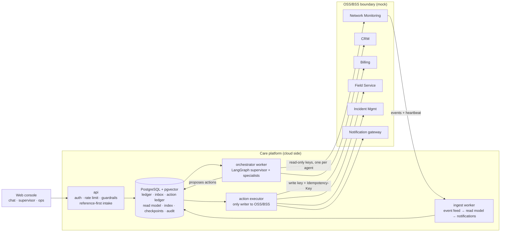

# Execution plan — G3 Telco outage-aware customer care agent

| | |
|---|---|
| **Scope** | Engineering plan for the working demo system (submission items 4 and 5) and the evidence it must produce for items 3, 6 and 7 |
| **Inputs** | `Group 3 - Telco_ Outage-Aware Customer Care Agent.pdf` (brief, **[B]**) and `G3_Telco_FDE_Action_Plan.pdf` (team delivery plan, **[AP]**) |
| **Baseline** | 15 Nov 2026. Submission 29 Nov 23:59 IST, presentation 30 Nov |
| **Relation to [AP]** | [AP] decides *what* and *why*. This document decides *how it is built, in what order, and how each claim is proven*. It does not restate [AP] |
| **Revision** | r3, 15 Nov — r2 revised the plan after an independent plan review and an architecture review (changes marked ▲); r3 records M0 and M1 as built, and what three code reviews changed |

Section 13 is a living progress log. Everything above it is the plan.

---

## 1. Definition of done

The build is done when each brief metric has a named, repeatable proof. Targets are from [B]. The first three rows have a measured result on the stand-in data (section 13); the others do not yet.

| Brief metric [B p.2] | Proof the build must produce | Built in |
|---|---|---|
| Outage detected for affected customers ≥ 95% | `evals/outage_detection`, scored as defined below | M2 |
| Unnecessary truck rolls cut ≥ 50% (simulation) | `evals/truck_rolls`: the kinds of contact that ended in a technician visit in the labelled data, replayed through the new workflow with a customer who goes on asking for one; also reports needed visits booked and the delay the hold adds | M2 |
| Credits match policy 100% | `evals/credit_policy`: independent exact-arithmetic oracle incl. 499.99 / 500.00 / 500.01, caps, rounding, prior credits; eligibility and amount both checked | M2 |
| Zero duplicate tickets per node | Concurrency tests: simultaneous contacts, response-loss retries, worker restarts, suspected-fault-then-confirmed-outage → exactly one incident per node episode, distinct complaint references | M1, M2, M3 |
| Available during a 10x surge | `loadtest/`: 1 contact/s → 10/s within 15 min, held 15 min, repeated with the Network API down. Pass: ≥ 99.5% of offered contacts accepted, every reference ≤ 120 s, first intake never rate-limited | M3, re-run on the full stack in M5 |
| Complaint reference within 2 minutes | Reference issued in the intake transaction before any model or dependency call; latency recorded for every contact (count, max, percentiles; internal goal p95 ≤ 5 s) | M1 |
| Curveball: safe degraded mode | Fault drills. Pass: zero false all-clear messages, zero dispatches on stale data, zero unauthorised credits, reference still issued | M3 |

**▲ How outage detection is scored.** The denominator is every contact from a customer whose *true* node is in outage at contact time, including contacts made before the NOC has declared the outage and customers whose mapping is defective. A contact counts as detected when it receives either an active-outage reply at contact time, or a suspected-fault hold at contact time followed by confirmation once the NOC declares the outage — and in both cases no device flow or dispatch was started. The report splits detected-at-contact, held-then-confirmed and missed, each by mapping status. Without the suspected-fault path and mapping repair (rules 3 and 4 below) the ceiling on the stand-in data would be about 77%, so those two rules are not optional.

Rubric items this build feeds directly: working agentic system (15), guardrails/security/compliance (10), evaluation and observability (8), curveball (6).

---

## 2. Starting position and assumptions

Facts on 15 Nov: the project folder contains only [B] and [AP]. The datasets, credit policy, router guides and mock APIs that [B] calls "provided" are **not** in hand, and no LLM credential is configured on the build machine. The plan is built so that work proceeds now and the unknowns stay cheap to correct.

| # | Assumption / default taken | Why it is safe to proceed | To confirm with | Cost if wrong |
|---|---|---|---|---|
| A1 | Supplied data pack and mock APIs are unavailable, so we build stand-ins: `skylink_datagen` (seeded synthetic data at brief scale) and `mock_oss` (stateful mock REST APIs with fault injection) | The agent system reaches them only through typed adapters and file loaders | Mentors / OSS-BSS architect | Rewrite adapters + loaders (bounded: `adapters/`, `pipelines/`); re-run evals |
| A2 | Credit policy content is unknown. A **synthetic placeholder policy** (`data/policies/credit_policy.v0.yaml` + policy document) drives a versioned, data-driven engine | [AP] forbids inventing a formula *as fact*; the placeholder is labelled, versioned and replaced by editing data, not code | Regulatory Affairs / mentors | Replace YAML + document + oracle table |
| A3 | The intake-ledger reference **is** the official complaint number; it is registered with Incident Management asynchronously | Only design that meets 2 minutes while Incident Management is down | Regulatory Affairs | Add reserved-range allocation |
| A4 | Credits > INR 500 always need supervisor approval. Credits ≤ INR 500 are also held for agent review (`CARE_CREDIT_REVIEW_ALL=true`) until mentors confirm auto-apply | [AP] p.2 default; one config flag flips it | Mentors | None (config) |
| A5 | LLM access goes through one narrow gateway. An **offline deterministic provider** is the default (tests, CI, surge fallback). The real provider defaults to Claude; the model actually permitted at demo time is undecided | The course labs used OpenAI/Azure via LangChain; the gateway interface keeps a second provider to one small class | Team | Add one provider class |
| A6 | Demo runtime is Docker Compose. AWS is the reference target per [AP] ADR-01; no cloud spend until the team freezes the choice | Containers + PostgreSQL are cloud-neutral | Team (R2) | Architecture document only |
| A7 | NOC events arrive as an ordered change feed (sequence number, per-outage version, heartbeat). Locally this is an HTTP feed on the mock; in the target it is a Kinesis/Kafka stream | The consumer depends only on ordering, versions and heartbeat | NOC manager | Swap the feed client |
| A8 | Write APIs accept an `Idempotency-Key` and replay the original response for the same key and body | If they do not, the executor's own ledger plus lookup-before-retry still prevents blind repeats | OSS-BSS architect | Executor retry path only |
| A9 | Mobile is a thin path using the supplied static node mapping; no live tower inference | [AP] scope decision; one mobile journey is built and evaluated in M2 | — | — |
| A10 | No churn ML. A transparent repeat-contact flag (≥ 2 contacts in 7 days) may raise human-queue priority only; it never changes entitlement or wait order for service. An ADR records why the ML layer of the reference architecture is deferred | No outcome labels exist; avoids unfair treatment by segment | R1 | — |
| ▲ A11 | A remote line test reports the node that actually serves the line. It is used to repair missing, ambiguous and stale mappings | Read-only probe; without it defective mappings can never be detected as affected | OSS-BSS architect | Defective mappings go to the human queue instead |
| ▲ A12 | Network Monitoring exposes active alarms per node, and equipment alarms precede the NOC's outage declaration | This is what closes the 1–10 minute pre-detection window | NOC manager | Fall back to line-test clustering only |
| ▲ A14 | Proactive messages go only to customers whose consent record allows outage notifications **at the moment of sending**, on the channel that record names. One message per customer, outage and kind (started, resolved); an ETA change sends nothing. "Resolved" goes only to those who were sent "started". An outage learnt more than 15 minutes late is recorded but not announced | Consent can be withdrawn at any time; a late or repeated message is worse than none | Regulatory Affairs, Contact Centre Head | Change the fan-out rule in `ingest/reactions.py` and the two templates |
| ▲ A15 | No rule for closing a complaint has been supplied. A contact that waits for the customer (after "service restored", or after an unanswered question) is closed after 24 hours of silence, and at once when the customer confirms service is back. A message after closure reopens it for a person | A complaint that never closes is as wrong as one closed too early; the period is one setting | Regulatory Affairs | `CARE_CLOSE_QUIET_SECONDS` |
| ▲ A16 | While the network status cannot be verified the contact is looked at again every 60 s and handed to a person after 5 looks (5 minutes). A suspected node fault (alarm, no declared outage) waits up to 15 minutes, because the NOC needs minutes to declare; meanwhile one ticket is raised for the node and each complaint is linked to it, instead of one handoff per contact | Queues people only for what cannot settle by itself; all limits are settings | NOC manager, Contact Centre Head | `CARE_NETWORK_RECHECK_*`, `CARE_SUSPECTED_WAIT_SECONDS` |
| ▲ A13 | A customer who is not signed in and not on a recognised caller line is verified by two things they know: customer ID and the last four digits of the registered mobile, checked by the CRM. A typed ID alone is only a claim: nothing is looked up, disclosed or attached to the contact for it, and a wrong claim gets the same answer whether or not the account exists | Stops the conversation being used to discover accounts or another customer's outage status | Contact Centre Head, Regulatory Affairs | Swap the factor (for example OTP) inside the triage agent |

---

## 3. Architecture as built

One repository, one container image, four care processes with separate credentials (API, orchestrator, executor, feed consumer), one database. The mock OSS/BSS gateway stands in for the on-prem boundary.



| Reference layer [B p.4] | Implementation | Package |
|---|---|---|
| 1 Channels | Static web console (chat, call-transcript intake, supervisor queue, contact audit trail); AI disclosure on first message | `skylink_care/web` |
| 2 Guardrails | Auth, rate limit, injection and PII checks in; grounding, citation and status-claim validation out | `skylink_care/guardrails`, `api` |
| 3 Orchestrator | LangGraph `StateGraph`, Postgres checkpointer, thread = contact; deterministic supervisor routing; step, tool-call and time budgets | `skylink_care/orchestrator` |
| 4 Specialists | Triage, network diagnostics, troubleshooting (RAG), resolution and credit, dispatch, proactive notification | `skylink_care/agents` |
| 5 Human gate | Approval bound to the exact frozen request, policy version and expiry; verified again by the executor | `skylink_care/approvals` |
| 6 Tools and systems | One gateway key per agent identity, so each agent can reach only its own tools (enforced at the API boundary and by which clients a process is given); typed OSS adapters; every tool call audited; credit engine in code | `skylink_care/adapters`, `observability`, `domain` |
| 7 Data and ingestion | Event consumer and outage read model; customer → service → node pipeline with quality flags; versioned guide index; transactional inbox/outbox | `skylink_care/ingest`, `pipelines`, `rag` |
| 8 Trust and operations | Audit log, OpenTelemetry traces, Prometheus metrics, eval harness, CI/CD, runbook | `skylink_care/observability`, `evals/`, `deploy/` |

Design rules that every milestone must keep:

1. **Reference first.** Contact, complaint reference and inbox row commit in one transaction before any model, CRM or network call. Intake has its own connection budget and a first contact is never rate-limited; overload is answered with a reference and status "queued".
2. **Evidence decides, language explains.** Branching uses typed state (outage status, test result, policy output). The LLM classifies intent and writes text; it never computes amounts, eligibility or network status.
3. **▲ Three-state network truth, asymmetric.** `ACTIVE`, `CONFIRMED_CLEAR`, `UNKNOWN`. Either fresh source (live status, or a caught-up event read model) may prove an outage. Only a fresh live answer may prove its absence, and only when nothing is suspicious: no critical alarm on the node or its parent, no cluster of failed line tests on the node. A timeout, a silent feed or an old answer is `UNKNOWN`. Customer wording is "no outage has been reported", never "there is no outage".
4. **▲ Probing is free, acting is gated.** A line test is read-only: it runs whenever the node is not known to be in outage, and its reported serving node repairs a defective mapping. Device guidance and dispatch need `CONFIRMED_CLEAR`. Dispatch additionally waits out the NOC detection window after the first failed test and re-checks immediately before booking.
5. **▲ One writer, frozen requests.** Agents propose actions into the action ledger; the row stores the exact request body. Only the executor process holds write credentials. It re-checks policy, approval, duplicates and current preconditions, then sends the stored body unchanged. A retry replays the same key and body; a changed request is a new, superseding action.
6. **▲ Identities are ours, enforced by constraints.** Complaint: one per contact. Incident: one per care-owned *node episode* (one open episode per node and service; the NOC outage id is attached when declared, so a suspected fault and its confirmed outage share one ticket). Credit: one per service per outage. Visit: one open visit per service.
7. **▲ Events are applied exactly once.** Every event for a contact lands in a per-contact inbox. A worker holds a per-contact database lock for the whole run, resumes the thread with a bare wake signal, and the graph drains the inbox from a cursor stored in checkpointed state. Redelivery, batching and stale versions are therefore harmless.
8. **▲ Threads stay small and end.** Thread state holds ids, the evidence summary and the inbox cursor; transcripts and tool outputs live in their own tables. A contact that closes ends its thread and its checkpoints are deleted.

---

## 4. Stack

| Concern | Choice | Note |
|---|---|---|
| Language, packaging | Python 3.12, `uv`, lockfile committed | Matches course labs |
| API | FastAPI + uvicorn | `/health`, `x-request-id`, `x-actor` as in course labs |
| Orchestration | LangGraph 1.2 + `langgraph-checkpoint-postgres` | `interrupt` / `Command(resume=…)`, async node timeouts and retry policies |
| Database | PostgreSQL 17 + pgvector, `psycopg` 3, plain SQL migrations | One stateful dependency: ledger, inbox, action ledger, read model, vector index, checkpoints |
| Queue | Inbox and action ledger in PostgreSQL, claimed under advisory locks | Maps to SQS FIFO (message group = contact) in AWS; no broker to run locally |
| Retrieval | Mandatory metadata pre-filter (device model, doc type, role) → pgvector; local `bge-small` embeddings via `fastembed` | ▲ Lexical search and rank fusion are added only if recall@3 misses its target |
| LLM | Gateway with offline deterministic provider and a Claude provider (official SDK, structured outputs) | Prompts are Markdown files versioned by content hash |
| Observability | Audit log in Postgres with an in-app per-contact trail; OpenTelemetry traces, Prometheus metrics, Grafana dashboard and alert rules (`grafana/otel-lgtm`, optional Compose profile) | ▲ LangSmith dropped |
| Tests and load | pytest, pytest-asyncio, pytest-cov, respx; Locust | Coverage gate 80% |
| Delivery | Docker Compose; CI with lint, type-check, tests, coverage gate, image and secret scan | ▲ CI moves to M1. Terraform is cut to a service-and-cost table unless time remains |

Reuse check: public LangGraph customer-support templates are LLM-routed chat demos without durable intake, an inbox or idempotent writes, so none is forked. The build relies on framework primitives instead of hand-rolled equivalents (checkpointing, interrupts, retries, timeouts).

---

## 5. Repository layout

```
├── docs/                    execution plan, ADRs, contracts, runbook, threat model
├── src/
│   ├── skylink_care/        the agent system
│   │   ├── domain/          pure logic: references, credit engine, network decision, dispatch rules
│   │   ├── db/              pool, SQL migrations, repositories
│   │   ├── adapters/        typed OSS/BSS clients (network, crm, billing, field, incident, notify)
│   │   ├── agents/          the six specialists
│   │   ├── orchestrator/    graph, state, routing, worker
│   │   ├── executor/        action executor worker
│   │   ├── ingest/          event consumer, read model, notification fan-out
│   │   ├── pipelines/       customer → service → node load and quality profile
│   │   ├── rag/             chunking, embedding, index, retrieval
│   │   ├── guardrails/      input, output and PII controls
│   │   ├── llm/             gateway, providers, prompts
│   │   ├── api/             FastAPI app, auth, rate limit, routes
│   │   ├── observability/   logging, tracing, metrics, audit
│   │   └── web/             static console
│   ├── mock_oss/            stand-in OSS/BSS gateway (never imported by skylink_care)
│   └── skylink_datagen/     seeded synthetic data and knowledge pack
├── data/                    knowledge/ and policies/ committed; generated/ ignored
├── evals/                   frozen cases, harness, reports
├── loadtest/                Locust profiles
├── tests/                   unit/ integration/ contract/ e2e/
└── deploy/                  Compose overrides, Grafana provisioning, CI
```

---

## 6. Milestones and exit gates

Dates follow [AP] p.3; owners are the [AP] roles. A milestone closes only when its gate passes from a clean checkout. ▲ Each milestone ships the evaluation module for what it builds, so M5 only freezes, runs and reports.

| # | Dates | Owner (reviewer) | Delivers | Exit gate |
|---|---|---|---|---|
| **M0 Foundations** | 15–16 Nov | R3 data · R4 mock, adapters · R5 scaffold (R2) | Scaffold, Compose, settings, migrations; synthetic data + knowledge pack; mock OSS/BSS with scenario and fault controls; typed adapters; data profile | `make up seed` then contract tests green at small scale; one CRM and one Network call return typed results; mapping-quality profile written |
| **M1 Reference-first outage path** | 16–18 Nov | R4 (R2) | Intake ledger + inbox; complaint reference; API auth and tool-broker interface; orchestrator on Postgres checkpoints; triage; customer and node resolution; network decision; outage reply with sourced ETA; node episode + shared incident through action ledger and executor; audit trail; minimal chat page; **CI pipeline**; eval: reference latency | E2E test against running mocks; worker killed mid-run resumes without repeating a write; retry returns the same reference; 50 concurrent contacts on one node create one incident and 50 references; CI green |
| **M2 Six capabilities** | 19–21 Nov | R3 retrieval · R4 flows (R5) | Event ingest and read model; consent-checked proactive notification; line tests and mapping repair; suspected-fault hold; guide index and cited troubleshooting; credit engine, approval gate, billing write; dispatch with hold-down, consent and one-open-visit; conflict handling; handoff queue; supervisor console; one mobile journey; evals: detection, truck rolls, credit oracle, retrieval | Three named input changes flip the outcome: (1) start an outage on the customer's node → outage reply instead of troubleshooting; (2) change the router model → a different guide is cited; (3) move the outage duration across the INR 500 boundary → supervisor approval appears. Credit oracle 100% |
| **M3 Curveball and resilience** | 22–24 Nov | R5 (R4) | Timeouts, bounded retries and circuit breaker per dependency; `UNKNOWN` mode with status-claim validator; stale-feed detection; ambiguous-write replay; duplicate and out-of-order event replay; surge mode and load test; half a day held for the curveball *as released*, with an ADR recording the re-scope | Network-API-down drill and surge both meet the pass lines in §1; no duplicate effect after response loss |
| **M4 Trust** | 19–24 Nov, alongside | R5 (R1) | Roles; per-agent identity and broker enforcement; PII masking and log redaction; injection and retrieved-document checks; grounding and citation enforcement; toxicity and off-topic refusal; intent-confidence threshold → human with summary; loop limits; human override, logged; audit fields for model, prompt and policy version; segment-parity eval (consumer vs SME: same outage → same credit and dispatch); data inventory with retention; regulatory-controls map; threat model; 20-case attack suite | Attack suite: zero critical failures (unauthorised credit, stale-data dispatch, cross-customer disclosure, false all-clear) and pass rate reported per LLM provider; negative tests for wrong customer, wrong role and unauthorised tool; no raw identifier in any model payload |
| **M5 Evaluation and observability** | 25–26 Nov | R3 · R5 (R1) | Freeze the evaluation set; run everything on the full stack at 400,000-customer scale, including the surge re-run with auth and rate limits on; generated report with online-metrics and drift plan; dashboard (latency, errors, cost, groundedness) and alerts (error rate, latency, cost spike, stale feed); ADRs; checklist evidence index | One command regenerates the report with counts, denominators and failures; each alert shown firing once |
| **M6 Demo** | by 26 Nov | R4 (all) | Console polish, seeded demo fixtures, scripted six-minute story, live-input changes | Demo runs in ≤ 6 minutes from a clean start; a mentor-chosen customer, node or router model works |
| **M7 Freeze** | 27 Nov | R2 · R5 | Fresh-clone check, image and secret scan, pinned dependencies, deployment strategy with rollback exercised once, service-and-cost table, README with AI-assistant declaration | Fresh clone → running demo using only the README |
| **M8 Rehearsal** | 28 Nov | All | Full 30-minute rehearsal, backup recording | Backup MP4 plays offline |

Development and CI run at small scale (40,000 customers by default); 400,000 is the evaluation and load profile. If the schedule slips, cut in [AP] order: UI polish, Grafana, optional cloud topology. Never cut the six capabilities, mock-API integration, approval, failure handling, reference timing or evaluation evidence.

---

## 7. Work breakdown, M0–M3

Each task lists its acceptance check. Tests are written first for `domain/` and the ledger logic.

### M0 Foundations

| Task | Acceptance |
|---|---|
| Scaffold: `pyproject.toml`, lockfile, ruff, mypy, pytest, Makefile, `.env.example`, `.gitignore`, Dockerfile, Compose (Postgres + pgvector for the care platform; the mock keeps its own SQLite store so the boundary stays honest) | `make lint test` passes; `docker compose up` healthy |
| `skylink_datagen`: nodes and topology; addresses; customers; services; address → node map with injected gaps (missing, ambiguous, stale); 6 months of alarms and outage events; 20,000 labelled transcripts; consent flags | Same seed → identical files; scale flag; schema in `docs/contracts/data.md` |
| Knowledge pack: 12 router guides with model-distinct facts, placeholder credit policy, placeholder complaint-handling rules; one deliberately hostile document for guardrail tests | Each guide has stable section ids; every model differs on at least five checkable facts |
| `mock_oss`: Network Monitoring (status with active alarms, line test, event feed + heartbeat), CRM, Billing, Field Service, Incident Management, Notification; scoped API keys; `Idempotency-Key`; admin scenario and fault controls | Contract tests per endpoint; replay of the same key returns the same result; fault modes: down, latency, error rate, timeout, response loss after write |
| Typed adapters with a `Result` type (ok / error kind, source timestamp, external reference), timeouts and correlation headers | Contract tests against the running mock; every failure mode maps to a typed error, never an exception leak |
| Customer → service → node pipeline and mapping-quality profile | Coverage, ambiguity and staleness counts written to `reports/data_profile.md` |

### M1 Reference-first outage path

| Task | Acceptance |
|---|---|
| Complaint reference generator (sequence-backed, check digit) | Unit tests: format, uniqueness, check-digit validation |
| Intake: `POST /v1/contacts` writes contact + reference + inbox row + complaint-registration action in one transaction and returns before any dependency call | Same `client_request_id` → same reference; dependency outage does not affect the response |
| Inbox worker: per-contact advisory lock for the whole run, head-of-line ordering, attempt count, dead-letter to handoff | Two workers never run one contact at once; a crash releases the lock and the event is re-run harmlessly |
| LangGraph graph with Postgres checkpointer; one `await_event` interrupt resumed by a wake signal; inbox cursor in state; deterministic supervisor routing; budgets | Redelivered and batched events are applied once; restart resumes from the last checkpoint |
| Triage: identifier extraction, CRM lookup, intent; offline provider now, LLM provider behind the same interface | Unknown or ambiguous identity → reference kept, human handoff, no account data disclosed |
| Diagnostics: mapping lookup, live status with alarms, network decision with evidence | Unit tests cover every row of the decision table, including timeout, stale, conflicting and suspicious cases |
| Outage reply: template-backed status and ETA with source; no device flow while `ACTIVE` | Reply contains reference, outage id, sourced ETA, next step |
| Node episodes, action ledger with frozen request bodies, executor; incident create and complaint link | 50 concurrent contacts → one incident, 50 references; a replayed action sends the identical body |
| Audit trail on every step; minimal chat page; CI pipeline | One contact shows a complete step-by-step trail; pipeline green |

### M2 Six capabilities (summary)

Built in slices, each committed when its tests and a live run pass: **A** event feed, read model, timers · **B** proactive notifications and restoration · **C** line tests, mapping repair, line-test clustering · **D** guide index and cited troubleshooting · **E** credits, approvals, billing write · **F** dispatch · **G** conflict path and mobile journey · **H** supervisor console · I evaluations. All nine are done (see the progress log).

Event consumer with dedupe, version checks, applied-sequence tracking and heartbeat; alarm state per node; notification fan-out to resolved mappings only, consent checked at send time, one message per customer, outage and template; line-test tool and mapping repair; suspected-fault hold (critical alarm, or several failed line tests on one node) that opens an episode without an outage id; retroactive confirmation when the outage is declared; index build and filtered retrieval; step-by-step guided troubleshooting with citations; credit proposals only after restoration, priced from frozen inputs; approval records carrying the hash the approver saw; billing write under a per-customer lock; dispatch rules (failed re-test, fresh `CONFIRMED_CLEAR` after the hold-down, customer consent, one open visit per service); conflict path for "the network says outage, the customer says device"; handoff queue with summary; one mobile outage journey.

### M3 Curveball and resilience

The curveball as stated in [B p.2]: the Network Monitoring API goes down during a live outage, and every outage contact must get a complaint reference within 2 minutes; the build must show a safe degraded mode (no false "all clear", no truck dispatch on stale data). Most of the answer is in design rules 1, 3 and 4, built in M1 and M2: the reference is issued before any dependency call, a status that cannot be verified is `UNKNOWN` and never "clear", and acting needs proof. M3 adds what a surge on top of a failed dependency needs, and proves the whole of it. Built in slices like M2:

| Slice | Task | Acceptance |
|---|---|---|
| A | Circuit breaker per dependency in the one HTTP path (closed; open for a rest period; one probe), producing the `CIRCUIT_OPEN` result that callers already understand as "not attempted". One bounded retry for idempotent reads that fail fast | A dependency that keeps failing is called once per rest period, not once per contact. Every caller reads "not attempted" as "not verified", never as "nothing found". The HTTP layer never repeats a write |
| B | One live status read per node at a time: diagnoses of the same node that run at the same moment share the read that is on its way. An answer that has arrived is not kept for the next caller, not even for a second, and a turn woken by the feed does not share at all: it must not be answered with the status from before the news | Contacts on one node that are diagnosed together make at most half as many status calls as there are contacts; the re-check before a booking always reads for itself |
| C | Status-claim validator on every outgoing message: what a message claims about the network is declared with its template and checked, where messages are stored, against the evidence of the turn | A message that says the network is clear cannot be stored without fresh `CONFIRMED_CLEAR` evidence, whatever path produced it; a blocked message is audited and the customer gets the "not verified" wording |
| D | Operations queue: a failed or blocked action that belongs to no contact (a notification, a ticket update) and a feed that needs a person are queued for staff, shown on the staff desk and closed there | Nothing that needs a person exists only as a log line |
| E | Surge mode and load test: under load intake still answers with the reference and says that the reply will take longer; triage falls back to the rules while the backlog is long; `loadtest/` ramps from 1 to 10 contacts a second and holds, then repeats with the Network API down | At least 99.5% of offered contacts accepted, every reference within 120 s, no first contact rate-limited, in both runs |
| F | The curveball as an evaluation (`evals/curveball`): a live outage with the Network API down in each fault mode, with the feed healthy and with it silent; an ADR for the re-scope | Zero false all-clear messages, zero visits offered or booked on unverified data, zero credits without approval, a reference for every contact, one incident per node episode |

---

## 8. Test and evaluation strategy

| Layer | What it covers | Runs against |
|---|---|---|
| Unit | `domain/` (credit engine, network decision, references, dispatch rules), guardrails, chunking | Nothing external |
| Integration | Repositories, inbox, action ledger, checkpointer, retrieval | Real PostgreSQL |
| Contract | Each adapter and each mock endpoint, including fault modes | `mock_oss` in process |
| End to end | Full contact journeys through API, workers and mocks | Compose stack |
| Evaluation | Brief metrics (detection, truck rolls and credits are built; surge and reference time are M3), retrieval quality (built), attack suite and segment parity (M4) | `make eval`: the in-process stack and frozen cases; the Compose stack at full scale in M5 |
| Drills and load | Dependency failures, restarts, 10x surge | Compose stack with fault injection |

Rules: frozen expected outcomes before the final run; counts and denominators in every report; a dropped contact is a failure, not a deflection; evaluation cases are kept apart from prompt tuning; every report states which LLM provider produced it, and the attack suite is re-run on the demo provider once D2 is settled; coverage gate 80% on `skylink_care`.

---

## 9. Demo script to feature map

| Segment [AP p.11] | Needs | Milestone |
|---|---|---|
| 0:00–1:30 Outage starts, consenting customer notified, then contacts care | Scenario control, ingest, notification, outage path | M1 + M2 |
| 1:30–2:45 Confirmed-clear customer, correct router guide, tests fail, visit booked | Line test, retrieval with model filter, dispatch (hold-down shortened for the demo and shown on screen) | M2 |
| 2:45–4:15 Network API down and feed stale; new contact; retry | `UNKNOWN` mode, idempotent intake, dispatch block | M1 + M3 |
| 4:15–5:15 Credit above INR 500, supervisor approves, retry | Credit engine, approval gate, executor replay | M2 |
| 5:15–6:00 Trace, scorecard, incident dedupe, consent-denied suppression | Audit trail, eval output | M5 + M6 |

---

## 10. Submission artifacts fed by the build

| Item [B p.3] | From the build |
|---|---|
| 3 Architecture document | `docs/adr/`, diagram and flows in this plan, dependency failure table from M3 drills, service-and-cost table from M7 |
| 4 Repository + README | The repository; `.env.example`; AI-assistant declaration |
| 5 Demo + backup video | M6 script and fixtures |
| 6 Evaluation report | `reports/` generated by the per-milestone eval modules, M3 drill and surge output |
| 7 Checklists | `docs/evidence_index.md`: each checklist line → test name, config line or log; each unticked line (for example managed secret store and encryption at rest, which exist only in the target design) → a one-line reason |

Items 1, 2, 8 and 9 (deck, problem statement, ROI workbook, contribution matrix) are outside this plan; the data profile and evaluation numbers are their inputs.

---

## 11. Risks

| Risk | Mitigation |
|---|---|
| ▲ Contacts in the 1–10 minutes before the NOC declares an outage are told nothing is wrong and get a technician | Alarm-based suspicion, line-test clustering, dispatch hold-down, "not reported" wording; scored as misses if any of these fail |
| Supplied mocks arrive late with different contracts | Adapters isolate contracts; contract tests show exactly what breaks |
| Placeholder credit policy mistaken for the real one | Policy version `v0-placeholder` appears in every credit record, reply and report |
| Live LLM unavailable or slow during the demo | Offline provider and templates give a complete, safe path; backup video recorded after freeze |
| Surge backs up the orchestrator | Known-active nodes take a template path with no LLM call; per-node single-flight status cache; ETA changes are read at the next turn instead of waking every thread; executor serves complaint registration, incidents and credits before notifications |
| Node-mapping gaps depress detection | Measured in M0; repaired by line test where possible; the rest goes to a human queue and is reported as coverage |
| Scope creep in UI | Console is static and thin until M6 |

## 12. Decisions needed

| # | Decision | Default in force | Needed by |
|---|---|---|---|
| D1 | Are the supplied datasets, policy and mock API contracts available? | Build on stand-ins (A1) | 16 Nov |
| D2 | Which LLM and provider is permitted for the demo? | Offline provider; Claude provider ready behind the gateway (A5) | 18 Nov |
| D3 | May credits ≤ INR 500 be applied without review? | Review all (A4) | 19 Nov |
| D4 | AWS or Azure for the reference deployment and cost estimate? | AWS (A6) | 16 Nov ([AP]: freeze on day 2) |
| D5 | Is the ledger reference the official complaint number? | Yes (A3) | 18 Nov |
| ▲ D6 | Where does the repository live and which CI runs it? | GitLab CI | 17 Nov |
| ▲ D7 | Does the curveball as released differ from the one built in? | As stated in [B] | On release |
| ▲ D8 | May a line test run before the network is confirmed clear, to repair a defective mapping? ([AP] p.6 says confirmed-clear only) | Yes, read-only probe (A11) | 18 Nov |
| D9 | Is customer ID plus last four digits of the registered mobile an acceptable identity check for unauthenticated contacts? | Yes (A13) | 19 Nov |

## 13. Progress log

| Date | Milestone | Status |
|---|---|---|
| 15 Nov | Plan | r1 written; reviewed independently for completeness and for architecture; r2 incorporates both |
| 15 Nov | **M0 Foundations** | **Done.** Gate met: Compose stack healthy; data pack generated (400,000 customers in about 15 s) and loaded (about 5 s); adapters pass contract tests against the mock; mapping profile in `reports/data_profile.md` (coverage: broadband 96.86%, mobile 96.78%) |
| 15 Nov | **M1 Reference-first outage path** | **Done, except that CI has not run on a runner.** Gate met by tests and by a live run: reference issued at intake (10–20 ms locally); worker killed mid-run repeats nothing; retry returns the same reference; concurrent contacts on one node share one incident; restart between turns resumes the conversation |
| 15 Nov | M4 items pulled forward | API roles and object-level access, per-agent gateway keys with least privilege per process, PII masking, log and audit redaction, per-caller rate limits, identity verification (A13) |
| 15 Nov | **M2 slice A: event feed, read model, timers** | **Done.** A fifth process (`care-ingest`) reads the NOC feed with its own read-only key and applies each event, its consequences and the cursor in one transaction. The network decision now has both sources: the feed proves an outage while the Network API is down; a silent, stale, lagging or gapped feed proves nothing. Timers wake a contact later (re-check, quiet close) |
| 15 Nov | **M2 slice B: proactive notifications and restoration** | **Done.** Declared outage → consent-checked messages to the customers on the node, "resolved" only to those told it started. A suspected fault raises one ticket for the node, which the declared outage upgrades. Waiting customers are told when the outage is confirmed and when it is resolved; the contact closes on their confirmation or after a quiet period |

| 15 Nov | **M2 slice C: remote line tests** | **Done.** A line test names the node that really serves the line, which repairs a missing, ambiguous or stale mapping for the contact (the three defective-mapping journeys now end in the outage reply instead of a human queue). A failed line on a node that looks healthy is watched for the NOC's detection window before any repair is arranged; three distinct lines failing on one node are treated as a suspected node fault with one ticket. Dispatch itself is slice F |

| 15 Nov | **M2 slice D: guide index and cited troubleshooting** | **Done.** The twelve router guides are indexed by section in PostgreSQL (text search and pgvector). With a clear node and a passing line, a customer who asks gets the steps for their own router model, quoted with guide, section and version; a different router model gets a different guide for the same complaint (gate input 2). Steps are given once. On a turn the platform starts itself the customer is told the checks are clear and asked, not instructed |

| 15 Nov | **M2 slice E: service credits, approvals, billing write** | **Done.** At restoration a credit is worked out by the policy engine from Billing's record and the NOC's outage times, proposed with its amount frozen, and approved through the API by an agent or, above INR 500, a supervisor (gate input 3: one more hour of outage moves the credit past the limit and the approval to a supervisor). The executor applies it under a per-customer lock, after checking again, on what is true then: the request against its hash, the approval the amount requires, the account for an existing credit, and the billing-cycle cap. The customer is told the outcome of every credit; the contact stays open until then |
| 15 Nov | **M2 slice F: technician visits** | **Done.** A line that still fails after the hold on a node proven clear is offered a visit with the earliest free slots; the customer's reply is read by rules, narrowly; the chosen slot is proposed as an action tied to the message that chose it, and the executor books it after applying the same rule again to evidence it reads itself (node state, the line's last test, Field Service's bookings). An outage declared after the offer, or between the choice and the booking, means no visit. One booking in progress per service is a database constraint |
| 15 Nov | **M2 slice G: disputed outage, mobile journey** | **Done.** A customer who says the fault is their own equipment, or asks for a technician, during an outage is told the outage with its evidence and why nothing is arranged for their equipment while it lasts; said again for the same outage, a person takes it. Mobile is a thin path (A9): tower outage told, ticketed, restored and credited by the mobile rule, with no router wording, no line test and no visit; on a working tower a person takes over |
| 15 Nov | **M2 slice H: staff desk** | **Done.** A second page of the console for an agent or a supervisor: the credits that wait for a decision (the frozen request, its working, approve or reject with a note) and the queue of contacts passed to a person (handover summary, conversation, audit trail, closed with a note; the closure is audited with who closed it). Staff sign-in through the dev token endpoint now needs a staff key and takes a name, so a decision is attributable and the endpoint no longer hands an approver's token to whoever can reach the port |
| 15 Nov | **M2 slice I: evaluations** | **Done.** `make eval` replays contacts through the real workflow and writes a report for three of the brief's metrics and for retrieval (`evals/reports/`, method in `evals/README.md`). On the stand-in data: outage detected for 97.47% of affected contacts (target 95%); credits match the policy in 4,050 of 4,050 cases; the workflow books none of the baseline's 3,225 unnecessary visits and every needed one, and what is left end to end is decided by people; the right guide section for 81.25% of descriptions the retriever was not built on. The first runs missed and said why: five transcript phrases were answered as out of scope (detection 91.44%), and search by shared words found the right section for 77.6% of the transcript phrases. Both were fixed in the product, not in the scoring |
| 15 Nov | **M3 slice A: circuit breaker and bounded retry** | **Done.** One circuit for each API of the gateway, in the single HTTP path: five failures in a row rest the API for ten seconds, calls to it are answered `CIRCUIT_OPEN` ("not attempted") without being made, then one call probes. A read that fails fast is tried once more; a timeout is not, and the HTTP layer never repeats a write. Every call has a limit on its whole duration. With the Network API down, 30 contacts cost at most 19 calls instead of 60 and more, each gets its reference and the "can't verify" wording, none an all-clear; an account lookup that was not attempted is never an account that was not found; a write to a rested API is recorded as not sent and lands once when the API is back |
| 15 Nov | **M3 slice B: shared status reads** | **Done.** Diagnoses of one node that run at the same moment share one read of its live status; nothing is kept once the read has finished. Twelve and more contacts on a node in outage make at most half as many status calls as there are contacts. Two callers do not share: a turn woken by the feed, which must see the node as it is after the news, and the executor before it books a visit |
| 15 Nov | **M3 slice C: no claim about the network without proof** | **Done.** Each of the 33 templates a conversation can send declares what it claims; a message is stored only if the network decision of its turn backs the claim, and that decision and the status it rests on must both be less than a minute old. A step that acts on what it is about to say asks first, so no credit, ticket or booking is proposed on the strength of a message that will not be sent. A stopped message is audited and the contact goes to a person at once. The full suite passes with the check on every message, which is the evidence that no path of the workflow says more than it has proved. Journeys with a defect put in on purpose (an all-clear on an unverifiable status, an outage announced on a clear node, "service restored" with the Network API down and the feed stale) end with the message stopped, a person told and nothing done. The customer's page takes "none reported" back after a minute, and a resolution is announced only while its feed event is current |
| 15 Nov | **M3 slice D: operations queue** | **Done.** What needs a person and belongs to no contact is queued instead of only logged: a failed, blocked or long-delayed write that no conversation waits for, and a feed that cannot go on by itself. One open item for one kind of trouble; it keeps how the trouble began and counts when it is seen again. All staff see the queue on the desk; operations staff and supervisors close an item, with a note, and the closure is audited. Raising an item can never be what stops the feed or the executor |

### Evidence at this point

- `make test-all`: 2,105 tests pass (unit, integration on PostgreSQL, adapter contract tests against the mock, end-to-end journeys); 95% branch coverage on `skylink_care`; `ruff` and `mypy --strict` clean.
- `make eval`: the four evaluations meet their targets on the stand-in data, in process, with the offline rules. Detection: 97.47% weighted over 140 replayed contacts on 32 nodes. Credits: 4,050 of 4,050 grid cases and 14 of 14 hand-worked amounts. Technician visits: 0 of 28 unnecessary ones booked by the workflow (all 28 customers, who went on asking, ended with a person), 10 of 10 needed ones booked, a median of 10 minutes after the contact. Retrieval: 81.25% on the 48 independent descriptions as first scored (constant answer: 47.92%; 89.58% on today's rules, no longer out-of-sample), 99.07% and 96.67% on the two in-sample sets, no answer from another router model's guide.
- `make smoke` passes against the host processes at 400,000-customer scale (eight journeys with `make demo`, which shortens the hold before a visit to 20 seconds; seven with `make dev`): declared outage → sourced reply, one incident, complaint linked, and 168 neighbours on the node notified once each (none without consent, checked in the gateway's own store); Network API down → the feed still proves the outage; same failure for a customer on another node → no all-clear and no device steps; outage resolved → the waiting customer is told, confirms, the contact closes and the node's incident is resolved; a failing line on a healthy node → held, nothing booked; a passing line on a healthy node → steps from the guide for the customer's own router, with the source; a five-hour outage → credit proposed, approved by an agent through the API, applied to the account once; the held line still failing after the hold → a visit offered with three slots, the customer chooses the second, one appointment booked for exactly that slot.
- `make smoke` also passes against the container stack (40,000 customers), where the feed consumer runs as its own service. Its first run there failed, usefully: re-seeding the gateway restarts its event sequence and empties its tickets, while the care database still held the cursor and ticket references of the previous gateway. The consumer refused the feed (sequence running backwards) exactly as designed. `make seed` and the container set-up now clear the care platform's runtime state in the same step (`care-admin reset-runtime`, refused unless `CARE_ENV` is `dev` or `test`).
- Both desks were checked in a browser at 1440 px and 375 px after slice H: sign-in as a supervisor, a supervisor-level credit approved, a case opened and marked done, the audit trail opened from the customer desk with the staff key; no console errors, no horizontal overflow.
- After M3 slices A to D, against the local stack at 400,000-customer scale: `make smoke` passes all eight journeys with `make demo` (the check waits out the circuit's rest after the journeys with the Network API down; without that wait six checks failed, which is the breaker doing its work). The staff desk's Operations panel was looked at in a browser at 1440 px and 375 px, signed in as operations staff: two items listed with the more urgent first, one closed with a note and gone from the list, no console errors, no horizontal overflow. On the customer's page the network chip read "none reported" with its time and, a minute later, "not verified".

### What the code reviews changed

Three independent reviews of the code (Python, security, silent failures) were run after M1 first passed. The findings that were real and are now fixed and covered by tests:

| Finding | Fix |
|---|---|
| The loop guard outranked the phase, so a handed-off contact could be handed off repeatedly until the run failed | Terminal phases are checked first |
| An event that committed late with a lower sequence number could be skipped by the inbox cursor | Writers for one contact are serialised by a row lock, so sequence order is commit order |
| A failed run was retried at once and exhausted its attempts in seconds; dead-lettering was not atomic and told nobody | Exponential back-off per contact; dead-letter, handoff, status and a message to the customer commit together |
| An unexpected exception could stop the executor or the orchestrator for good | Both loops and every action are guarded; an unexpected error becomes "outcome unknown" |
| A write whose answer could not be read, or that met an auth failure or an unexplained conflict, was recorded as failed | Only definite rejections fail; everything else is replayed with the same key and body, a person is alerted after 8 attempts, and the action is closed for manual reconciliation after 24 hours |
| A failed or blocked write was visible only in the ledger | It opens a handoff and logs an error |
| A message sent after a contact was handed off was dropped without trace | It raises a follow-up handoff and an audit record |
| The token-minting endpoint for local demos existed whenever `CARE_ENV` was unset | The default environment is `prod`; the endpoint exists only when `dev` is set on purpose |
| Every local process was started with every secret | Each process receives only its own variables, on the host launcher and in Compose; settings are no longer read from `.env` implicitly |
| A customer ID typed into a message was treated as identity | Two-factor knowledge check (A13); claims are never attached to the contact |
| Masking could be bypassed with dots, invisible characters or full-width digits; free text of unidentified customers could reach the model | Text is normalised before masking; unidentified customers' text never leaves the platform; the audit trail stores no customer text |
| A channel integration could read every contact; a customer could label a contact with someone else's session | Channel access is limited to contacts it opened; sessions come from the token |
| A literal `..` in an identifier could address a different API resource | Dots are escaped in path segments |

### What the reviews of M2 slices A and B changed

The same three independent reviews were run on these slices before they were committed. No critical finding; the real ones, now fixed and covered by tests:

| Finding | Fix |
|---|---|
| A customer told "outage active" in the instant the NOC resolved it could wait for ever: the resolution event skipped a conversation whose turn was still running, and nothing else would wake it | The event is queued for running turns as well; the turn compares its answer with the read model before it finishes; and every customer waiting on a declared outage has a slow watch on the live status behind the feed |
| A hole in the feed sequence, or an outage event that could not be applied, was passed over. If the lost event was a resolution, the outage stayed "active" for ever and was trusted | The read model is marked as having a gap and stops being used as evidence (the live status still is) until an operator has reconciled it and clears the mark (`care-admin feed-status`, `feed-clear-gap`). Later events are still applied |
| A feed whose sequence ran backwards looked healthy while saying nothing new | The page is refused, the error recorded, and the heartbeat not refreshed |
| A notification replayed after an unanswered first attempt could be recorded as skipped although it had been delivered, which also withheld the "resolved" message | Every decision not to send first asks the gateway whether the earlier attempt went out |
| Text from the feed (an outage id) went into customer messages unchecked; one event could name any number of nodes | Identifiers must match a strict pattern and every field of a feed event is bounded, on arrival |
| A timer re-armed by a repeated workflow step could already have fired, leaving the contact waiting on nothing | The timer key includes the inbox position of the turn; a timer that cannot be armed fails the run loudly |
| An off-topic remark from a customer waiting on an outage moved them to "waiting for the customer", where silence would have closed the contact mid-outage | The wait on the network is kept |
| A ticket raised by a turn could miss an upgrade or a closure that the feed consumer applied while the turn was running | The turn re-reads the episode after raising the ticket and proposes what the consumer could not |
| An alarm without a stated severity counted as harmless; an outage named on an aggregation node reached no customer; an update that widened an outage told nobody on the added nodes | Unknown severity counts as critical; aggregation nodes are expanded to the access nodes below them; added nodes are treated as newly declared |
| "It works now" closed the contact even when the same message asked for a credit or a technician | The contact closes only when nothing else is asked for |
| A failed audit write could suppress the alert for a failed action; the timer pump and the feed consumer could deadlock on contact rows; an unexpected consumer failure was only in the log | The alert no longer depends on the audit write; contact rows are locked in one order; the failure is recorded in the feed state |

### What the review of M2 slice C changed

One independent correctness review, before the commit. Fixed and covered by tests:

| Finding | Fix |
|---|---|
| The marker of a line hold survived an outage and its restoration, so a line fault found hours later skipped the hold and went straight to a repair handoff | The hold ends when the line passes or the customer has been told about an outage or its end; a later fault starts its own hold |
| Re-checks during the hold counted towards the "status unverified" limit, so one failed status read late in the hold ended it with the wrong reason | Re-checks during a hold are not counted |
| When the hold ended and the line could not be tested again, the earlier fault was forgotten and the customer was told the line looked fine | No result is not a clean bill of health: the test is retried, then a person takes over with the evidence (`LINE_TEST_UNAVAILABLE`) |
| A stale word of an outage in the read model spared the line its test although the decision no longer trusted it | The network state is decided first; the line is tested whenever that state is not a proven outage |
| A mapping that looked sound but named the wrong node was believed over the line test | The line test's node wins when it differs and the reference data knows it as active; an unknown or retired node repairs nothing |
| One customer with several lines could make a node look faulty; a line since found on another node still counted on the old one | Customers are counted, by the latest test of each of their lines |

### What the review of M2 slice D changed

One independent security review, and two findings from the live run. Fixed and covered by tests:

| Finding | Fix |
|---|---|
| Guide steps could be sent on a turn the platform started itself (a re-check hours after the customer wrote) | Steps are given only to a customer who has just written. Otherwise the customer is told the checks are clear and asked whether they still need help |
| "It works now" closed the contact after guide steps even when an outage had begun since | One flag records that the customer was asked whether the service works; any later news about the network withdraws it |
| Live run: "wifi keeps dropping" found the slow-speed section, because customers write "wifi" and guides "Wi-Fi", and other sections mention the word in passing | Spelling variants are folded on both sides of the search and a match on the section's own topic outranks passing mentions. Checked with ten customer phrasings against all twelve guides |
| Live run: a line test made two minutes earlier for another conversation was reused, so a line that had since failed was treated as healthy | A recent result is reused only within the same contact |
| Steps go to customers verbatim, and nothing checked what a guide's quotable sections say | The index build refuses a guide whose quotable steps tell the customer to reset, open the unit or touch the fibre, unless the step forbids it |
| A second guide for the same model could be indexed and a superseded section quoted; identifiers from a guide's front matter went into the citation unchecked | One guide per model; document id, version and model must have their fixed shape |
| The whole conversation was masked and searched on every guide turn, and the e-mail pattern was quadratic on long input | The search uses the customer's most recent text only; the pattern is bounded |
| A text with nothing to search for scored every section equally | No section is returned and a person takes over |

### What the review of M2 slice E changed

One independent security review of the money path, before the commit. It found no way to a credit without its approval, to a second credit for one service and outage, or for a model or a customer to move an amount. What it did find was in the life of a credit after the proposal. Fixed and covered by tests:

| Finding | Fix |
|---|---|
| The executor stopped replaying a write 24 hours after it was *proposed*, but an approval may take 72. A credit approved on the second day was ended by the first hiccup of Billing, and the customer was told it had not been applied although an attempt might have landed | The clock starts when an action becomes runnable: at the proposal, or at its approval (`actions.ready_at`). A credit the executor gave up on is reported as "could not be confirmed", to the customer and to the person who follows up, who is told to look for it on the account under its key first |
| A second outage on the same contact replaced what the contact knew about its first credit, so the first one's outcome was never told and a rejection reached nobody | A contact keeps every credit it waits for, one per outage, and is told the outcome of each |
| A credit that ended after the contact had gone to a person (or closed) was noted nowhere: no message, no handoff | The outcome is told from the follow-up path as well, once, and a credit that was not applied opens a handoff there too |
| The customer was told the amount worked out in the turn, not the amount frozen in the ledger. When a credit for the service and outage was on record already these could differ, and an earlier credit that had ended could leave the contact waiting for news that had long passed | Everything said about a credit is read from the frozen request. A credit on record is reported as it stands (in progress, applied, already on the account, not applied) and waited for only if it is still open; a different amount worked out now goes to a person with both figures |
| The billing-cycle cap was checked only when a credit was priced, against credits already applied. Two outages in one cycle could each be priced as if the other did not exist | Credits proposed and not yet settled count towards the cap at pricing, and the executor checks the cap again under the customer's lock, where the money moves; a credit that no longer fits is refused and goes to a person |
| The executor believed the ledger about which approval a credit needed, and never recomputed the request's hash | It recomputes the hash, works out the required approval from the amount under the policy, and takes the stricter of that and the ledger's. A credit priced under another policy version is refused |
| A credit on the account under the action's own key was sent again and left to the gateway's idempotency store | It is the answer to the earlier attempt and nothing is sent |
| A decision and its audit entry were two transactions; an approval past its time was still listed until the sweep ran | One transaction: a decision that cannot be recorded in the trail is not taken. Expired approvals are not offered |
| Each credit holds a database connection across two calls to Billing; a burst could starve the pool | At most two credits are written at once |
| A service with an unusable fee or cycle day was silently given no credit | A person reviews it; a fee that is not a positive finite number is never priced |

Found by the new tests while the fixes were written: a credit proposed by another conversation of the same customer differs from this one's request in its complaint reference alone, which made every second conversation about an outage look like a disputed amount. Amounts are now compared as amounts.

Not fixed then, and fixed with the staff desk (slice H): the token endpoint of `dev` mode gave a staff token to anyone.

### What the review of M2 slice F changed

One independent review, before the commit. It found no way to a visit on stale or missing evidence, or to a second visit for one service. It did find that the customer's word could be misread, and that a booking could be lost. Fixed and covered by tests:

| Finding | Fix |
|---|---|
| The reader of the customer's reply searched for a slot anywhere in the text. "I can't do 2", "not the afternoon", "wait a second", "I live on floor 2", "ok, how much will it cost" and "it works now ok" were each read as a choice or as a yes | The reply is read as a whole or not at all: every word must belong to naming a slot, be a plain yes, or be one of a short list of words that carry nothing. One word outside that, a negation anywhere or a question mark, and nothing is chosen. The customer is asked again |
| A letter that only looks like one of ours ("ſat") made the reader raise, and the contact ended in the dead-letter queue | Words are plain ASCII; anything else is not understood, and nothing is looked up without checking |
| The booking's key counted attempts in conversation state, which was reset whenever an offer was withdrawn. After a declined booking and a new offer the key repeated, the old finished action was returned, and the contact waited for an outcome that had already been | The key is the contact, the message that made the choice, and the number of times that choice was looked at again. A proposal that turns out to have ended already is treated as its outcome, not waited for |
| A message from the customer while the booking was with the executor replaced the booking in the contact's state with a new offer; the outcome was never told | A booking in progress is left alone: the customer is told it is still being made, and its outcome when it comes |
| When another conversation of the same customer was booking at the same moment, the second was told a visit "is already booked" although nothing was | It is told a visit is being arranged elsewhere; what Field Service shows when the customer next writes decides |
| Field Service keeps a visit `BOOKED` after its slot has passed, so one past visit refused every later one | Only a visit still to come counts as open, in the offer and in the executor |
| With an offer open, every message was taken for an answer to it: a customer still without service, or one whose service had come back, was told their reply made no sense, and after two such messages handed over as "could not book" | Only a message with no topic of its own is read as a reply to the offer. A fault report gets the slots afresh, "it works now" closes the contact, a bill goes to billing |
| A choice the customer made could be acted on after they had written again | A choice stands only while the message that made it is the customer's latest |

Not changed: the visit is offered on a turn the platform starts itself (the hold running out). The customer was told the answer would come, and it is an offer, not an instruction.

### What the review of M2 slice G changed

One independent review, before the commit. It confirmed that an old dispute cannot hand over or speak on a turn the platform starts, that a dispute counts only against the outage it was made in, and that a mobile contact cannot reach the line hold, the router guide or the visit. Fixed and covered by tests:

| Finding | Fix |
|---|---|
| The paragraph for a customer who disputes the outage told a mobile customer that "a technician visit" would not help | The mobile wording speaks of the phone and its settings only |
| A mobile customer whose network status could not be verified, or whose tower showed no outage, was told about a router, a technician and a line | Every reply on the mobile path takes the service type; a test builds each of them for a mobile service and looks for the broadband words |

Found by an existing test while the slice was written: with no outage id on record, "the outage this customer disputed" and "the current outage" were both nothing, and therefore equal, so a first complaint was handed over as a repeated dispute. A dispute now counts only against an outage that has an id.

### What the review of M2 slice H changed

One independent security review, before the commit. It found the key check sound (unset, empty or short keys admit nobody; compared in constant time; never logged or echoed), the name unable to impersonate a role, the closure atomic with its audit entry, and no way for a customer's text to reach the staff desk as markup. Fixed and covered by tests:

| Finding | Fix |
|---|---|
| The console's forms had no method. If a page's script failed to load, pressing Enter would have submitted the form by GET and put what was typed into it, the staff key included, into the address bar and the access log | Every form of the console posts; a test reads both pages and checks each form. Pages and scripts are served `no-cache`, so a new page never runs with a script the browser kept from before |
| The `channel` role, which is believed about who is calling, could still be had from the dev token endpoint without the key | Only a customer or a guest token is given without it |
| `make init` did not recognise `export KEY=value` as setting `KEY`, and would have added a second, generated value that most loaders prefer | Such a line counts as set |
| The note a person writes when closing a case went into the audit trail as written | It is kept as written with the case and masked in the audit trail, like everything else recorded there |

### What the reviews of M2 slice I changed

Three independent reviews, before the commits: two of the evaluations' validity (does each report claim only what its code measures) and one of the reworked symptom rules. They found the credit oracle independent of the engine, six hand-worked amounts right by their own arithmetic, the detection scoring faithful to its definition, and the weighted figure reproducible from the report's table. Fixed:

| Finding | Fix |
|---|---|
| The retrieval set called "held out" had been written by the author of the symptom rules in the same sitting, and some rule words occurred nowhere else. Its 96.67% was presented as an out-of-sample figure | It is called what it is, a second in-sample set. A separate model instance, shown one router guide and none of the retriever, wrote and labelled 48 descriptions; they were scored once (81.25%). The cases keep that figure with a hash of everything it was scored on (the retriever's code, the guides, the router models), and the report stops calling the set out-of-sample when any of it changes. What a constant answer would score stands next to every figure |
| The truck-roll report led with "a cut of 100%" and gave a worst case of 55.81%. The worst case was an artefact: the simulated customer stopped after asking once, and one who goes on asking always ends with a person | The simulated customer asks until a person takes over. The report says what a replay can show (the workflow books none of the unnecessary visits and every needed one) and what it cannot (what that person decides), with the dependence as its first table and the break-even in the headline. A contact that ends with neither a visit nor a person counts against the result |
| The fallback vocabulary added in this slice sent billing questions down the connectivity path ("my mobile data bill is wrong", "the payment page is not loading") | Only words that name a fault were kept, and a page that does not load counts as a connectivity complaint only when the message is not about a bill |
| The symptom rules misread ordinary phrasings, and each review found more: "internet is down, no lag" as slow, "wifi shows no internet" as Wi-Fi, a later "my phone is dead so I can't test" as a dead line, "I can't connect to the wifi" as a dead line, the Hindi "lagta hai" (it seems) as lag | Reworked twice on three stated principles, with a test for each misreading: what the customer rules out is not the fault (and is kept from the search too); a word like "dead" or "gone" counts only when said of the service; the service named as gone outranks the rest of the message. The in-sample figures did not move. The second rework was not reviewed again: keyword rules go on misreading what they were not given, and the out-of-sample figure is the measure of that |
| Figures typed into report text by hand; an alarm label printed for outages that were already declared, where it means nothing; a hand-worked amount failing two checks counted twice | Report figures are computed from the frozen mix; the label appears only where it applies; one entry per amount. Every report names the language-model provider that produced it |

### What the reviews of M3 slices A and B changed

Two independent reviews before the commit, the second of the fixes to the first and of the shared reads. They found no path on which a call that was not attempted is read as a fact (no such customer, no outage, nothing applied yet, consent not given), no way for the HTTP layer to send a write twice, and nothing in the launcher or Compose change that hands a process a variable it should not have. Fixed and covered by tests:

| Finding | Fix |
|---|---|
| The client's timeouts apply to each step of a call, so an answer that arrives a byte at a time never ends. As the probe of a rested API such a call would have kept the circuit open for the life of the process | Every call has a limit on its whole duration; past it the call is given up as a timeout (for a write: outcome unknown, replayed under its key) |
| A call that was already on its way when the circuit opened could close it by answering late, with no probe; one that failed late during the probe freed the probe's place, and a second probe could go out | A call is given a ticket that says which opening of the circuit it belongs to. A report from before the latest opening is ignored, and while the circuit is open only its probe's report counts |
| A full connection pool in this process was counted as a failure of whichever API the call was meant for | Nothing was sent, so nothing is held against the API: the caller is told "not attempted" |
| The end-to-end test of a rested write waited real fractions of a second and could pass without the circuit having refused anything | The rest is counted by a clock the test holds, and the test first waits for a write that was recorded as put off unsent |
| The launcher passed every `CARE_OSS_*` variable to three processes: a secret given that prefix one day would have reached all of them | The variables are named |
| A turn woken by the feed could join a status read that had been sent before the news that woke it. A contact woken by "outage resolved" would have been told the outage was still on, and waited a quarter of an hour for the next look | A turn that follows news from the feed reads the status for itself. Only a read on its way is ever shared, and the module says how much older than the question an answer can therefore be |
| A shared read cancelled before it began stayed registered, and every later caller for that node was handed the cancelled read | A read is forgotten when it ends, however it ends |
| A probe that found no free connection rested the API for another period, though nothing had been learnt about it | It gives its place to the next call |

One finding was not applied. The review held that a booking should be put off, not ended, when the executor cannot read the node's status at booking time. That would let a booking be made after the customer has written again: the executor cannot know whether their choice still stands. As built in M2 the executor declines, and the conversation, which does know, looks again and proposes the booking afresh if nothing has changed. A test of exactly that (`test_choice_does_not_outlive_a_later_message_from_the_customer`) failed when the change was tried.

### What the reviews of M3 slices C and D changed

Two independent security reviews before the commit, the second also of the fixes to the first. They found no way for anything a customer writes, or a gateway returns, to reach the network decision a message is checked against; no outgoing message stored anywhere but through the one checked function; no authorisation or injection fault in the operations queue; and nothing dangerous in how the staff desk shows an item. Fixed and covered by tests:

| Finding | Fix |
|---|---|
| "Your service should be working again" was stopped only while an outage was proven. With the Network API down the state is unknown, and it would have passed: the curveball case, held only by the routing | It needs the network confirmed clear, or the one case in which the feed is current, carries the NOC's own record of the resolution and shows nothing against it. A status that cannot be read does not back it |
| The customer's page showed the last network state for as long as the contact lived: "none reported" through a later outage, and after the same words had been stopped in a message | The contact keeps when the status was observed; the API gives "none reported" only while that is recent, and "not verified" after |
| A credit, a ticket and a booking were proposed before the message that goes with them was checked | Each of those steps asks whether its claim is backed before it does anything |
| Three visit messages said nothing of the network and promised a technician, so they needed no proof | Offering to book, and booking, need a node proven clear. The reply that lists free slots after a chosen one was taken promises nothing and needs none: checking it for a fresh decision, as a first fix did, stopped a legitimate reply whenever the booking answer came back more than a minute after the choice |
| A decision may rest on a status up to a minute old, and a message may follow its decision by up to a minute: the two ages added up | Both the decision and the status it rests on must be recent |
| The check of a message's words caught two of eighteen ways of saying that all is well | It is described as what it is, a tripwire for a copied sentence, and every template's wording is pinned by a test that fails when a text changes |
| "The outage has been resolved" was announced however old its feed event was | Like "an outage has started", only while the event is current. The waiting conversation is still woken and looks for itself |
| If the apology after a failed turn were ever stopped, the handoff would have been rolled back with it, and the turn tried again for ever | The handoff stands whatever happens to the apology, and a test holds the apology to claiming nothing |
| An operations item was written inside the feed page's transaction: a queue that refused it would have failed the page at every poll | It has a savepoint of its own; a queue that fails costs the item, not the page. The executor's alert is likewise logged and passed over if the queue refuses it |
| The feed failure that holds up everything behind it (a page that fails while it is applied) raised no item; neither did a rejected key, a removed endpoint or a feed out of reach for hours | Each raises one. Standing trouble is put to the queue once a minute, not once a poll |
| One item took every malformed event, and the later, lesser one overwrote what it said; an item's text was always the latest | An event that may hide an outage has an item of its own. An item keeps how its trouble began and holds the latest beside it |
| Only notifications were counted together: a ticket API down in a large outage would have been one item for every node | One item for each kind of write |
| The list is cut at a hundred and the page showed the length of the cut; one list failing to load blanked the others; a gateway's error text reached the item unmasked | The total is given with the list; each list is loaded for itself; the text is masked and what an item carries is bounded |

### Known gaps carried into M2 and M3

- After a handoff the workflow no longer speaks. A customer who disputed an outage twice was first told "I'll tell you here when it is resolved"; from the handoff on, that is for the person who holds the contact.
- A mobile connection has no remote test here, so a defective tower mapping for a mobile service cannot be repaired the way a line test repairs a broadband mapping: it goes to a person.

- A booked visit cannot be changed or cancelled here; the customer is told a person will help. A visit is not offered for a line that passes its test, however the customer describes the fault: that goes to a person after the guide steps.
- The executor takes the customer's consent and the service's state from the proposal; what it reads again is the network, the line and the bookings.
- Slot times are shown in Indian time whatever the customer's device says; the replies are English only, and so is the reading of the answer (a reply in another script is asked again, then goes to a person).

- Staff sign-in is a stand-in. In `dev` mode the token endpoint gives a staff token to anyone who knows the one staff key in `.env`, under whatever name they type; it does not exist outside `dev`. Real sign-in belongs to M4. The staff desk has no automated browser test: it was checked by hand at two widths.
- From the staff desk a person can decide a credit and close a case, not answer the customer: that happens on their own channel.
- A credit is offered only to a customer who contacted us about the outage. Whether every affected customer is credited is part of decision D3.
- An outage the NOC re-opens and resolves again is not credited for the added time: the first credit stands and a person is asked to review the difference. Reversing a credit is not built.
- The executor reads the fee and cycle day for the cap from what was recorded with the proposal, in its own database. Separate database roles (M4) are what would stop another process from changing them.

- Retrieval uses a deterministic hashing embedder, not a learned model (A5 and D2 are open). Which section is found rests mainly on keyword rules for the kind of fault, which know only the words they were given: 81.25% right on descriptions they were not built on, and the report lists what they still get wrong. That out-of-sample set is spent, because the rules were changed after it was scored; the next change to the retriever needs a fresh one. Guidance is one round: the best-matching section, once.
- The evaluations run in process on a 1,000-customer pack with the offline rules, weighted by the mix of the 400,000-customer pack. The run on the container stack at full scale, and on the demo's language model, is M5.
- How many unnecessary technician visits are avoided end to end is not measured, and cannot be by replay: the workflow books none, and a customer who goes on asking is handed to a person. If every customer insisted, the brief's 50% would hold only while people turn down at least half of them.
- Outage detection misses mobile contacts made before the NOC declares the outage when no alarm is up, and mobile contacts with a defective tower mapping: together 2.53% of affected contacts on the stand-in mix.
- Guide steps are quoted verbatim, including their cross-references to other sections of the same guide.
- A held line is tested again about every two minutes during the hold (bounded by `CARE_LINE_RETEST_SECONDS`), which keeps the per-node picture current at the cost of extra probes.
- Two outages that overlap on one node get one ticket each, opened one after the other. Each is closed with its own outage and they are never both open for the same outage, but the brief's "one ticket per node" is read here as one per node *episode*.
- A feed page that cannot be parsed, or that fails while it is applied, stops the consumer at that page. This fails safe (the read model goes stale and stops being trusted) and is now put to the operations queue, but it still needs a person: there is no dead-letter for feed events, and closing the item does not clear a gap (`care-admin feed-clear-gap` does).
- A failed action that belongs to no contact goes to the operations queue (M3 slice D). Nothing alerts on that queue yet: a person has to look at the desk (M5). If the database refuses the item at that moment, the log line is all that is left; nothing sweeps for it afterwards.
- The check of what a message claims rests on each template's declaration. The words are read too, but a list of phrases catches only a sentence copied from another template; what holds a template's wording is a test that pins it. A proactive notification is built from a recent feed event and sent within its own time limit, and is not checked against the network again when it goes out.
- A turn that fails and is taken up again more than a minute later no longer has a decision recent enough to back what it would say: the contact goes to a person instead of being diagnosed afresh.
- The customer's page shows an outage, or an unverified status, as last found with its time. Only "none reported" is taken back when it is no longer recent.
- One event can still queue a message for every customer on up to 2,000 nodes; there is no per-customer frequency cap on proactive messages. Feed events are applied per page, not per event.
- Every waiting contact re-reads the live status on its own timer. Reads of one node that happen at the same moment are shared (M3 slice B); an answer is not kept between them, so a quiet node with many waiting contacts is still read once for each.
- For up to the rest period (ten seconds) after a dependency comes back, the process that rested it still answers as if it were down: a customer who writes in then is told the status cannot be verified, and is put right by the timed re-check. The live journey check waits that long before it expects a real answer.
- A circuit belongs to one process and covers one API of the gateway. The orchestrator, the executor and the feed consumer each learn for themselves that an API is down, and a single resource that fails while the rest of its API answers is not rested. Circuit state is in the logs, not yet in a metric or an alert (M5).
- Fired and cancelled timers are never deleted.
- The Claude provider is unit-tested against a stand-in client and has not been run against the live API.
- The CI definition (`.gitlab-ci.yml`, with the new `eval` job) parses but has not run on a runner; image and secret scans are defined there and not yet executed. The repository is on GitHub (decision D6 is open).
- Each process still uses the same database role; separate roles are an M4 item.
